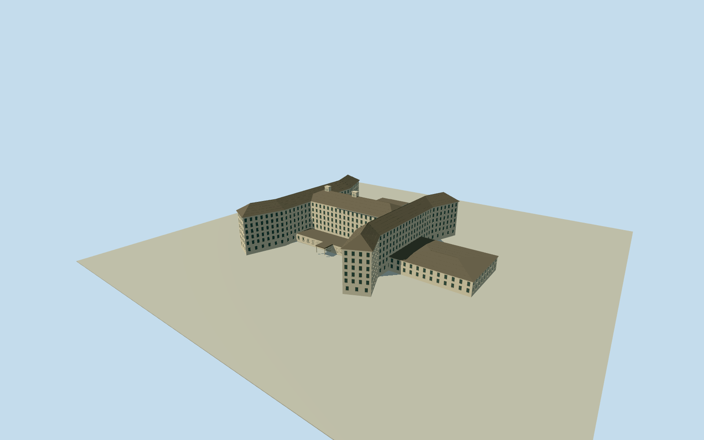

# Ambassador Hotel, Los Angeles

Opening-year1921historical Ambassador Hotel: complete H-shaped six-storey stucco guest block/four splayed arms/open courts, overhanging intersecting dark hipped roofs/terminal ridges and roof service stacks, traced larger lower casino/base, attached lower north dining/cafe block, rear kitchen/service projection and east indoor terrace/own open entrance canopy/threshold. Original period plans/aerial guide topology; exact upper floor/roof/window/section and street registration estimates. Historical-only1921; no modern hotel or current school model.

Authoring state: **review-in-qa.json**. Current completion evidence is in [qa.json](qa.json) and the [completion ledger](../../../../qualla-structures/batches/qualla-002.PROGRESS.md).

- [Ambassador Hotel, Los Angeles](https://qualla.com/ambassador-hotel-los-angeles/)

Former Ambassador Hotel reconstructed only for representative1921historical viewing. No surviving hotel roof polygon exists: current campus/park and modern named AmbassadorHotelmarker10933394774are not adopted as its plan/anchor. Exact native Catalina/Wilshirejunction123138044and Catalina/Eighthjunction123384153supply present-day street context. Approximate printed plot street-centre controls[1250,745]/[215,745]fit original north-right/east-down drawing to those retained intersections, giving about0.4343m/px. Original signed plot/footprints remain historic image evidence, not a modern survey. Main Hbase/casino trace and upper guest mass/roof inferred separately from actual1921aerial; original1405x660ftproperty text is a reasonableness control only, not a whole-site model. Changed street widths/paper reproduction and old building corners are unmeasured; registration/upper-floor sections remain bounded estimates.

Historical-only representative opening-year1921appearance, with explicit1921-01-01through1922-01-01viewing range. Photographs/plans were published in June/November1921; no exact exposure day, invariant later appearance or current surviving hotel is claimed. Modern school/park/marker are not substituted for former building geometry.

Four exact native Qualla originals were inspected:1921Comstockaerial and casino/base/basement plans, plus November1921BuildingReviewplot signed MyronHunt. Exact nativeSHA1/pinned publisher/date/archival plate/PD-US records qualify; omitted generated category for the plot is resolved by hash-bound primary dated-publication proof, with Qualla media metadata untouched. No later postcard/2004facade/interior/portrait, generated bitmap or copied pixels.

Whole central connected hotel assembly: six-storey Hguest block/four splayed arms and open courts, traced larger lower casino/base, low north dining/cafe/CocoanutGrove volume, rear kitchen/service and east indoor terrace/own open entrance canopy/threshold. Separate employee/garage ranges, detached resort cottages, gardens/tennis/roads/landscape, signage/artwork/interiors and modern campus excluded.

The lower plans are not surveyed upper guest-floor plans. Upper Hunion,22.8meaves/28.2mridges/31mservice stacks, roof intersections, sash/window census, low-block sections/roof shape and entrance/hidden construction are bounded interpretations of the aerial and historic base/block plans. Pale warm stucco and dark tile/wood/glass are medium-fi material estimates from monochrome sources; no exact historic color survey or engineering replica claim.

Native street junctions establish an approximate plot registration and metric scale, not original hotel corner surveys; changed road widths/paper reproduction introduce uncertainty. Raw300mcurrentTerrariumfield remains unchanged at fixed east entry.1921ground and modern campus grading differ; old footprint/threshold/bedrock/host contact remain unverified. No authored courtyard pavement or generic site slab.

Build: `node packages/worldgen/scripts/generate-authored-places.mjs --ids=ambassador_hotel_los_angeles`. Add `--check` to verify exact regeneration. 46176 triangles; 5 materials; no embedded photographs.
