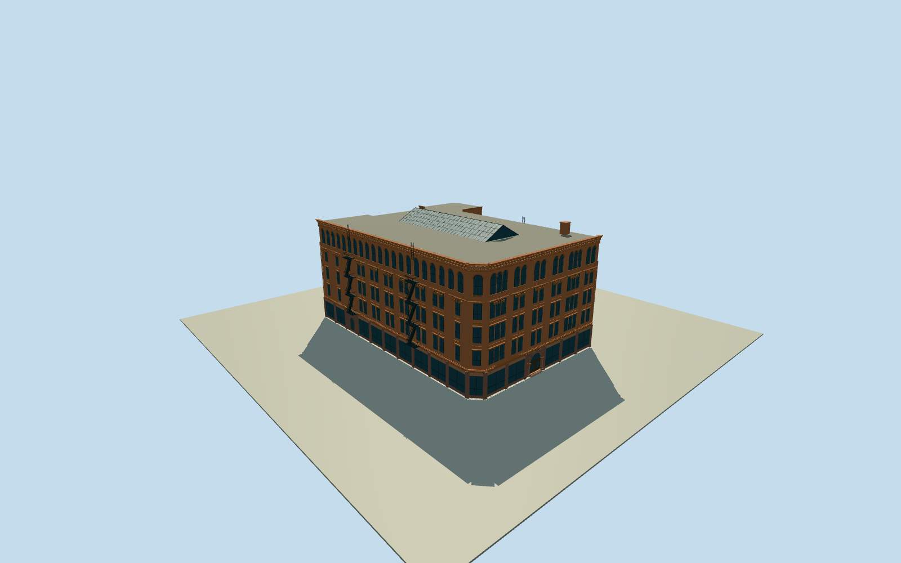

# Bradbury Building

Five-storey brick and terracotta exterior on native concave Broadway/Third Street plan, chamfered corner, paired rectangular middle windows and round upper windows, broad retail ground floor with arched Broadway portal, bracketed cornice, metal fire escapes, flat roof with opaque glazed ridge skylight and chimney. Exclude neighboring buildings, temporary retail signs, street scenery and navigable atrium.

Authoring state: **medium-fi-exterior-source-preview-reviewed-in-qa**. Current completion evidence is in [qa.json](qa.json) and the [local 100 ledger](../../../../qualla-structures/batches/PROGRESS.md).

- [Bradbury Building](https://qualla.com/bradbury-building/)

Photographic medium-fi exterior; native quantized2105.96m²plan and25.8mmapheight are controls rather than survey dimensions.

Exact bay spacing, relief artwork, fire-escape details, unseen rear levels and ridge skylight position are estimates. Opaque glazing excludes interior reconstruction.

USGS source field retained unchanged. One-metre source/export is not surveyed sidewalk/foundation accuracy or default Earth terrain certification.

Photo pixels are reference-only; ordinary shared catalog graphs provide materials. No generic footprint replacement or full-site terrain pad.

Build: `node packages/worldgen/scripts/generate-authored-places.mjs --ids=bradbury_building`. Add `--check` to verify exact regeneration. 24358 triangles; 7 materials; no embedded photographs.
