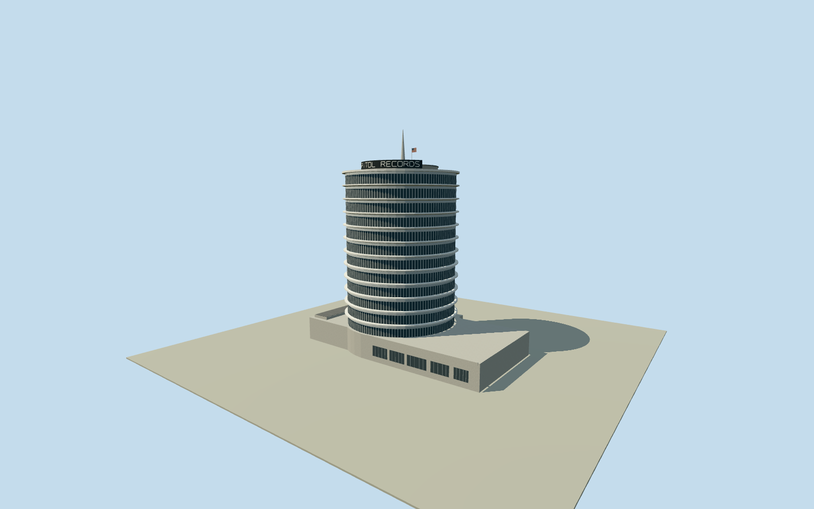

# Capitol Records Building

Thirteen-storey cylindrical Capitol Records Building, with pale stacked ledges, rooftop lettering and tapered antenna.

Authoring state: **review-in-qa.json**. Current completion evidence is in [qa.json](qa.json) and the [completion ledger](../../../../qualla-structures/batches/qualla-003.PROGRESS.md).

- [Capitol Records Building](https://qualla.com/capitol-records-building/)

July 2022 exterior. Individual window divisions, rooftop fixtures and spire height are approximate.

The separately painted mural and street furniture are outside this architectural scope. The original elevation field is preserved, with representative door and foundation details.

The blank side of the tower, main podium roof and concealed east elevations use simplified geometry.

Build: `node content/worldgen/source/places/9q/9q5/capitol_records_building/models/generate-house.mjs`. Add `--check` to verify exact regeneration. 7120 triangles; 5 materials; no embedded photographs.
