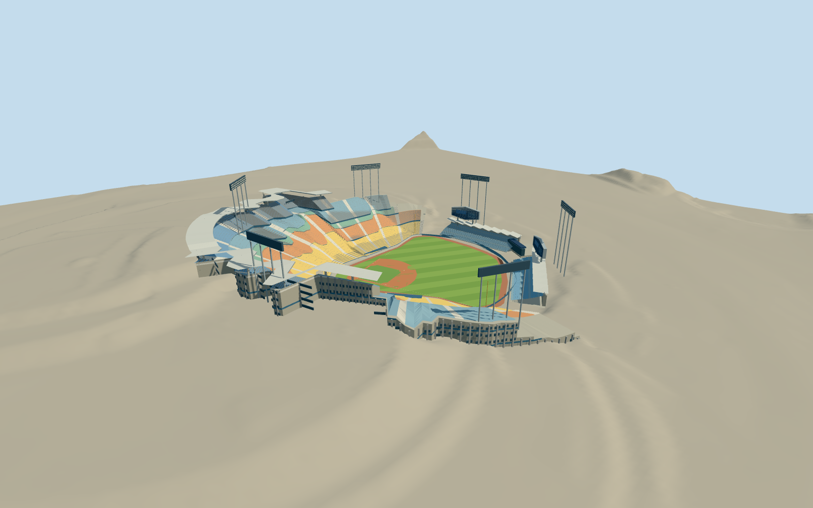

# Dodger Stadium

Dodger Stadium in Chávez Ravine, with a terraced main stand, low outfield pavilions, twin hexagonal scoreboards, four-post light banks and a baseball diamond.

Authoring state: **review-in-qa.json**. Current completion evidence is in [qa.json](qa.json) and the [completion ledger](../../../../qualla-structures/batches/qualla-003.PROGRESS.md).

- [Dodger Stadium](https://qualla.com/dodger-stadium/)

Unevaluated club interiors, advertising and scoreboard programs are omitted. Roof, mid-century exterior, concourse and riser details are schematic.

The bowl section and playing-field elevation use approximate exterior registration to the original USGS 3DEP field.

Build: `node content/worldgen/source/places/9q/9q5/dodger_stadium/models/generate-dodger-stadium.mjs`. Add `--check` to verify exact regeneration. 36722 triangles; 6 materials; no embedded photographs.
