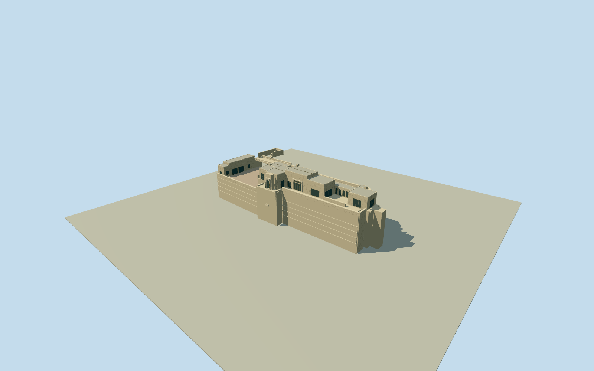

# Ennis House

Stepped buff textile-block house above massive retaining terraces, with projecting dining-window tower, high living-room block, rear loggia, eastern master room, western motor court, bridge and garage wing. Visible 16-inch block courses and restrained Greek-key relief.

Authoring state: **review-in-qa.json**. Current completion evidence is in [qa.json](qa.json) and the [local 100 ledger](../../../../qualla-structures/batches/PROGRESS.md).

- [Ennis House](https://qualla.com/ennis-house/)

Original government HABS CA-1942 west elevation and gate detail by Jean Davis,1969, establish the textile-block hierarchy and measured15ft10.75in portal. Gate figures, rods and relief are simplified. Current condition and unseen faces are approximate; earlier attribution/private/satellite imagery is excluded from the current review.

The retained mapped full compound and HABS exterior are corroborated by public USGS B23 point measurements acquired2023-01-08 through2024-01-07. Court datum is unchanged; bridge depth/height and the raised sloping entrance are corrected as approximate architecture. This derived local registration conservatively allows2m horizontal uncertainty, without an independent epoch/datum correction; inferred under-bridge paving is not an observed navigable survey.

House, linked garage/servant wing, bridge, court, terraces and pool basin included. Interiors, vegetation, neighboring houses, vehicles, temporary scaffolds, furniture and photo pixels excluded.

Original USGS raster, review grid and source heights remain exact. A bounded rendered-ground opening exists only under the authored solid entrance paving; the original raster interpolates bridge returns across this covered passage. Isolated portable views use a flat floor below the foundations; medium-fi views retain the original ground and exercise the opening. Host datasets may differ; placement remains a preview with footprint replacement disabled.

16-inch block course spacing is retained; ornate block relief and leaded-glass geometry are simplified at medium-fi and progressively omitted at distant detail levels.

Build: `node packages/worldgen/scripts/generate-authored-places.mjs --ids=ennis_house`. Add `--check` to verify exact regeneration. 58598 triangles; 5 materials; no embedded photographs.
