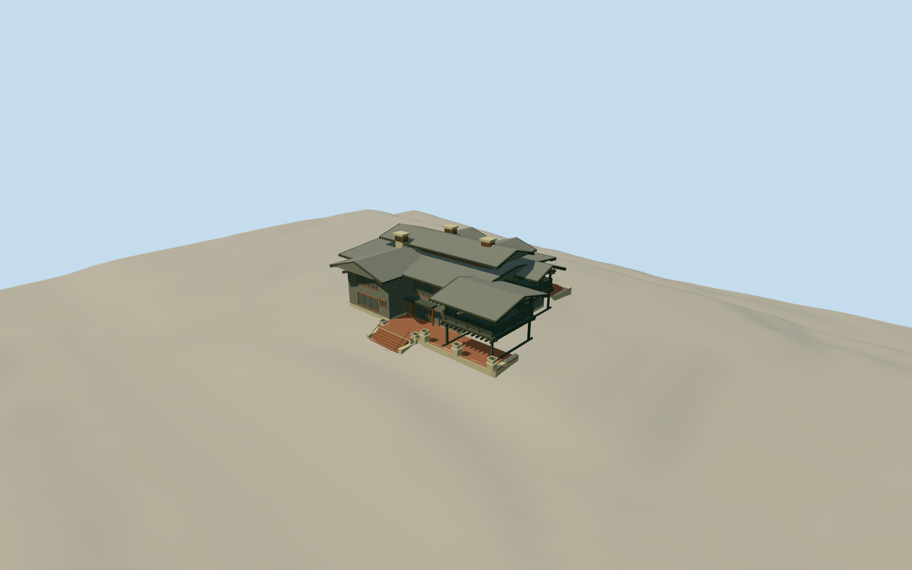

# Gamble House

Craftsman house with olive cedar-shake walls, overlapping broad gables and deep exposed timber eaves, raised attic, three open sleeping porches, warm timber casements and entry glass, three bracket-capped chimneys, gunite front terrace and fieldstone rear terrace.

Authoring state: **review-in-qa.json**. Current completion evidence is in [qa.json](qa.json) and the [local 100 ledger](../../../../qualla-structures/batches/PROGRESS.md).

- [Gamble House (Pasadena, California)](https://qualla.com/gamble-house-pasadena-california/)

Original medium-fi exterior from inspected local Qualla front/rear photographs, porch and entry details, local HABS construction section, online first-floor plan and aerial roof context. Dimensions, upper room boundaries and hidden roof joins are estimates, not survey data.

Main house and attached terraces only. Detached garage, interiors, furniture, vegetation, visitors and photographic pixels excluded.

Independent unmodified USGS CA_LosAngeles_B23 bare-earth tile retained. Ground under structures is interpolated by the source product; host terrain can differ. Footprint replacement remains disabled.

Cedar shakes, art-glass branches, beam-end profiles, terrace fieldstones and chimney brackets are simplified at medium-fi scale and omitted progressively at distance. No physical-device frame-rate measurement claimed.

Build: `node packages/worldgen/scripts/generate-authored-places.mjs --ids=gamble_house`. Add `--check` to verify exact regeneration. 28706 triangles; 6 materials; no embedded photographs.
