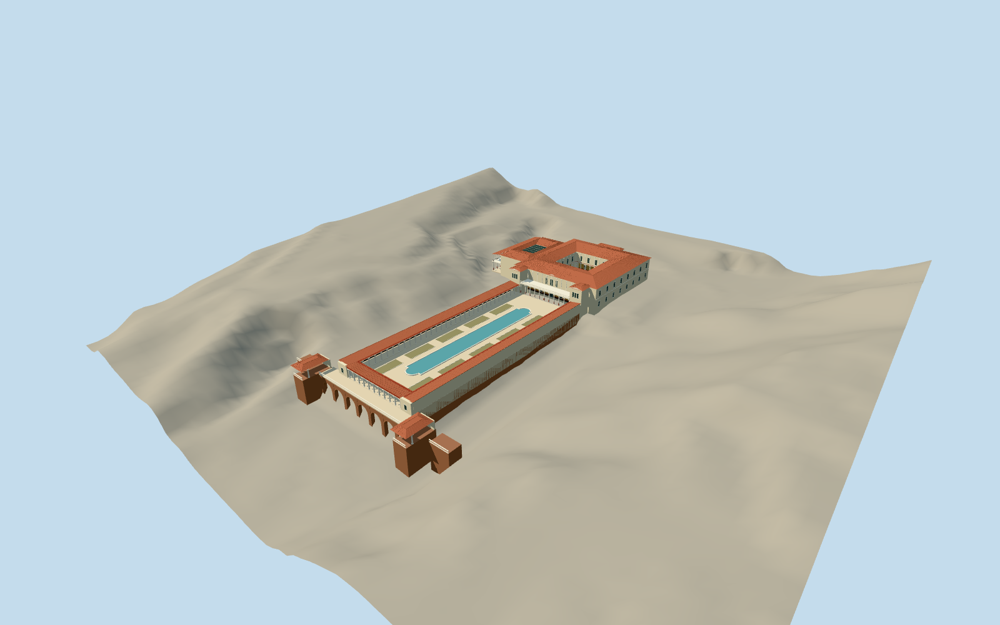

# Getty Villa

Roman villa museum with cream gallery ranges around an open inner peristyle, west atrium and double-height entrance porch, south balcony between projecting pavilions, long red-tile outer colonnade and shaped pool, with an attached brick-arched viewing terrace above sloping ground.

Authoring state: **review-in-qa.json**. Current completion evidence is in [qa.json](qa.json) and the [local 100 ledger](../../../../qualla-structures/batches/PROGRESS.md).

- [Getty Villa](https://qualla.com/getty-villa/)

New outer-pool broad beveled coping and24jointed curved-end panels from native cleared Qualla CC0aerial and two exact native Highsmith photographer-public-domain pool views/detail. Original basin footprint/water/inner walls/straight sides and all other original geometry retained; three lower levels exact. Full fixed museum/both peristyles/roofs/pools/attached terrace retained pending broader cleared exterior review. Earlier attribution/private visitor-plan/satellite controls excluded; hidden joins, gallery depths, heights, stone profiles/panel dimensions and fine ornament remain medium-fi estimates, not surveyed geometry.

Main villa, peristyles, pools and attached viewing terrace only. Modern theater, entry pavilion, cafe, auditorium, parking and separate campus buildings excluded. No artworks, vegetation, people, interiors or photographic pixels copied.

Independent unmodified USGS CA_LosAngeles_B23 raster 114605 retained. Bare-earth ground under structures is interpolated by the source; host terrain may differ. Footprint replacement remains disabled.

Column capitals/fluting, painted wall panels, roof tiles, balusters and brick arcade details are simplified progressively with distance. No physical-device frame-rate measurement claimed.

Build: `node packages/worldgen/scripts/generate-authored-places.mjs --ids=getty_villa`. Add `--check` to verify exact regeneration. 63705 triangles; 7 materials; no embedded photographs.
