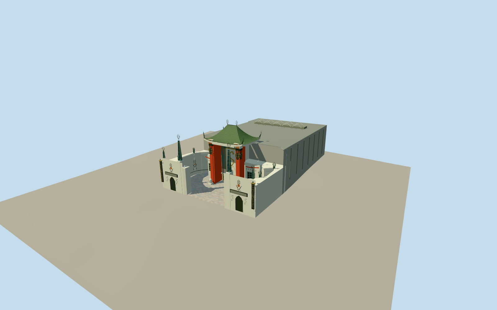

# Grauman’s Chinese Theatre

Dated2012–2014Chinese Theatre: retained native rear auditorium/curved open forecourt with paired south street gateway blocks/faceted bronze spires and CHINESEblades. One swept hipped green-bronze pagoda roof/short ridge/trident finials/upturned bladed corners; tall coral square posts with original geometric open-mouth wrought masks/tusks/looped whiskers. Stepped pale corbels/coral gold panels, deep grid-ceiling portico/round gong/stone dragon panel/separate small canopy/sun disk, golden paired doors with tiny pagoda slot frames and pale seated guardian lions. Lower grid-window wings/curved red band, court piers/niches/abstract flame+bell plaques; neutral blank marquees. Native ground unchanged/graded paving, no handprint microdetail/ad artwork/photo pixels/modern neighbors/interior.

Authoring state: **review-in-qa.json**. Current completion evidence is in [qa.json](qa.json) and the [local 100 ledger](../../../../qualla-structures/batches/PROGRESS.md).

- [Grauman's Chinese Theatre](https://qualla.com/grauman-s-chinese-theatre/)

Explicit2012–2014exterior with2008mask/2010guardian details. Current temporary display/signage/restoration finishes not claimed.

Native own44vertexfootprint and south forecourt indent retained. Nominal27.432mtop from preservation record; all other heights/roof sweep/ornament/hidden rear surfaces are proportional estimates, not drawings.

Original abstract geometric dragon/mask/lion/foliage shapes approximate observed relief. No handprint or incised landscape microdetail, photographs, advertisements, people, vegetation, vehicles or neighboring structures.

Independent terrain acquired before floor/foundation design; no flattening/model-fitted elevation.

Native auditorium18.1m and nominal27.432mpagoda top; roof curvature/court wall11.15m/gateway and spire heights/fine relief are unmeasured proportional estimates. Roof services generalized from aerial, not architectural survey.

Court paving follows broad independent urban elevation; actual handprint panels and door threshold/interior floor relationships omitted or estimated. Guardian/mask/dragon/niche relief is original simplified geometric interpretation, not a replica of every sculptural detail. Opaque glazing and neutral display panels; no temporary ad content.

Build: `node packages/worldgen/scripts/generate-authored-places.mjs --ids=graumans_chinese_theatre`. Add `--check` to verify exact regeneration. 35706 triangles; 7 materials; no embedded photographs.
