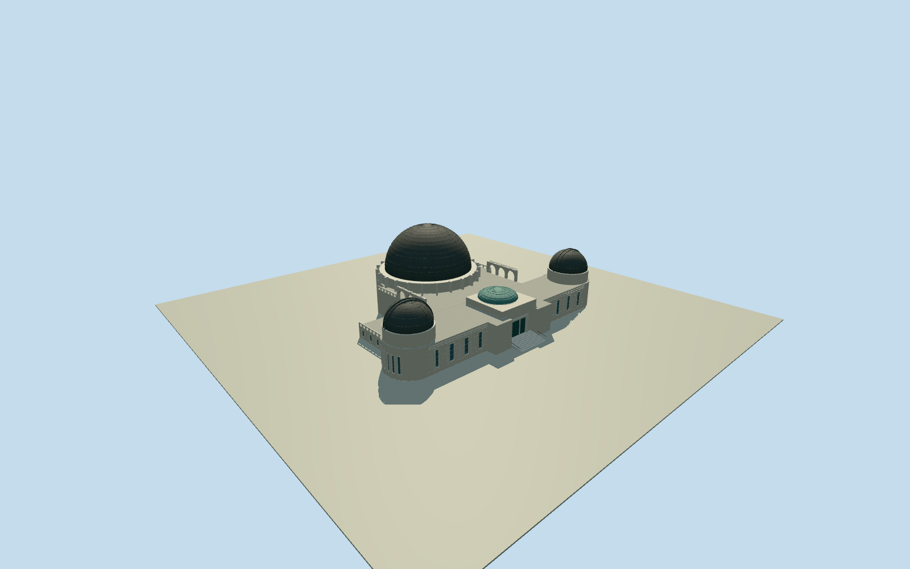

# Griffith Observatory

Whole Griffith Observatory: actual native78control envelope/closed lower construction volume and partitioned long front wings/central rear/eastern low terrace, large rear planetarium drum/radial buttresses/dark paneled copper dome, two smaller telescope domes with closed raised curved slit housings, cream recessed sash/piers/architectural Greek-key cornice, closed central entrance/intrinsic stairs/raised green crown, genuine open upper side arches and pierced parapets. Official main23.4696m and telescope16.764m heights above fixed front-lawn reference; exterior main dome25.908m diameter from enclosure engineer. Three distinct accepted creatorCC0/explicitHighsmithPD inputs only; failed local candidates excluded without repair or same-image bypass. Hidden lower east wing/sections/window census/roof/slit facing/current finish/ground contact are original estimates. No sculpture, lettered art/window designs/interiors/instruments/lamps/grounds/sourcepixels.

Authoring state: **review-in-qa.json**. Current completion evidence is in [qa.json](qa.json) and the [completion ledger](../../../../qualla-structures/batches/qualla-002.PROGRESS.md).

- [Griffith Observatory](https://qualla.com/griffith-observatory/)

Actual native way422130705/Q575901 named observatory closed79point ring/seventy-eight original controls. Fixed native bboxanchor/heading0/+Xeast/+Zsouth before field acquisition. Whole geometric envelope includes lower wings and rear circular projections; do not collapse to a generic podium or narrowly model the front. Native height35.9/ele371 tags are unverified map attributes, not surveyed architectural sections. Interpret aboveground floors/drum/dome/slit heights/terrace arches/window census/hidden roof originally from the three separately accepted photographs only after frozen original ground.

Original independent600m129x12916641sample/four rawtile/fixedSW325.7447m provider-relative field frozen before all floors/sections/geometry. Main-lawn reference 20.9099m relative to frozen datum fixed by original north-entry/lawn grid sample before geometry; not raised after rendering or fitted to grade. Original lower construction volume extends4.8m beneath lawn, with exact buried thresholds/contact unresolved. Official operator:236x176ft aboveground overall,77ft main dome/55ft telescope top above lawn; native whole71.56x53.73m footprint retained unscaled. Engineer85ft exterior copper dome distinguished from inner projection screen. Three separately cleared photographs support main circular planetarium/drum/dark panel dome/radial buttresses, long cream wings/two smaller closed-slit domes, recessed windows/piers/cornices/central entry-stairs/green roof crown and open upper side terrace arches/parapets. Native asymmetric eastern rear wing kept as original low terrace/service volume, not discarded or claimed surveyed; its exact height/hidden roof uncertain. Native lower footprint actually drives full lower walls, upper fronts/central rear/east wing partitioned from the same controls, no generic whole-property podium or facade-only scope. Hidden elevations/floors/roof/roomplan/window census/slit direction/cornice finish estimated. Sculpture/lettered bronze doors/ornate window artwork/inscriptions/interior exhibits/site instruments/lamps/lawn/trees/roads not copied. No terrainfit/flatten/reacquire/late modelraising; preview/replacementfalse/grade contact unresolved.

Three distinct individually inspected sources pass unchanged public-domain/CC0 inventory: native2023BenoitPrieur own/selfCC0 front, official Highsmith6144x4096native aerial and listed1228x1840side-arch detail, bound to exact catalog/files and explicit primary photographerPD dedication. Two published source candidates rejected unchanged guard, excluded; no source repair/reclassification or same-image bypass. Original architectural geometry/colors only, no copied bronze-door/window artwork/sculpture/name text/interiors/site instruments/lamps/grounds/photo pixels.

Whole native78control lower envelope/upper partitions retained. Eastern hidden low wing/service roof/sections/roomplan/window census/slit facing/fine finish and construction contact are original estimates. Published overall dimensions support native footprint; mapped35.9height/371ele not used as a survey. Original600m129x12916641samples/four rawtiles/SW325.7447m datum frozen before every floor/section/geometry choice. Main-lawn floor fixed20.9099m from untouched entry grid before geometry; no terrainfit/flatten/reacquire/late modelraising. Exact grade/threshold contact unresolved; preview/replaceFootprint=false. Flat ground and synthetic neighbors are review fixtures.

Build: `node content/worldgen/source/places/9q/9q5/griffith_observatory/models/generate-griffith-observatory.mjs`. Add `--check` to verify exact regeneration. 50807 triangles; 3 materials; no embedded photographs.
