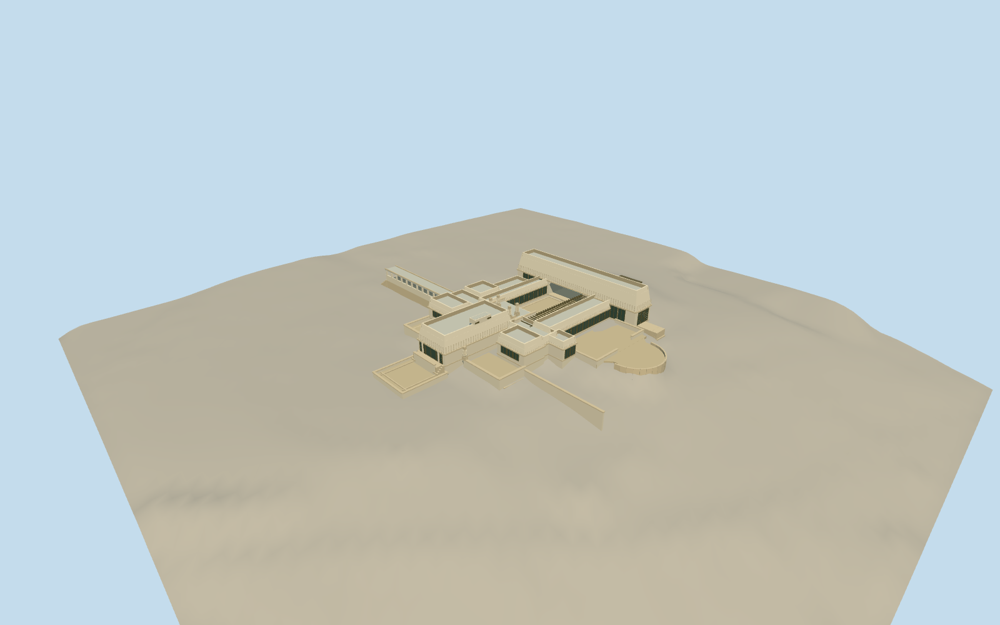

# Hollyhock House

Low buff stucco courtyard house with ten-degree battered upper walls, flat terrace roofs, geometric hollyhock friezes, west living-room projection and reflecting basin, raised west lawns, north entrance gallery, east upper bridge and circular pool, south garden and paired stair finials.

Authoring state: **review-in-qa.json**. Current completion evidence is in [qa.json](qa.json) and the [local 100 ledger](../../../../qualla-structures/batches/PROGRESS.md).

- [Hollyhock House](https://qualla.com/hollyhock-house/)

Original medium-fi exterior from individually inspected Qualla photographs, HABS CA-356 description, official 2024 museum floor plan and aerial roof context. Dimensions, hidden joins and relief are interpretations, not surveyed measurements.

Main house, north entrance gallery, attached terraces and basins included. Long northern pet pergola, other park buildings, interiors, vegetation, visitors, furniture, pool sculpture, temporary construction coverings and reference-photo pixels excluded.

Independent USGS CA_LosAngeles_B23 ground preserved unmodified. Ground under buildings is source-interpolated; host terrain may differ. Preview placement retains footprint replacement disabled.

The mapped 18.7 m height is rejected as incompatible with the documented one/two-storey house. Upper east range and bridge are authored at 8.4 m above entrance-garden datum.

Hollyhock relief and art-glass patterns are simplified and progressively omitted at distant detail levels. No physical-device frame-rate measurement is claimed.

Build: `node packages/worldgen/scripts/generate-authored-places.mjs --ids=hollyhock_house`. Add `--check` to verify exact regeneration. 28990 triangles; 6 materials; no embedded photographs.
