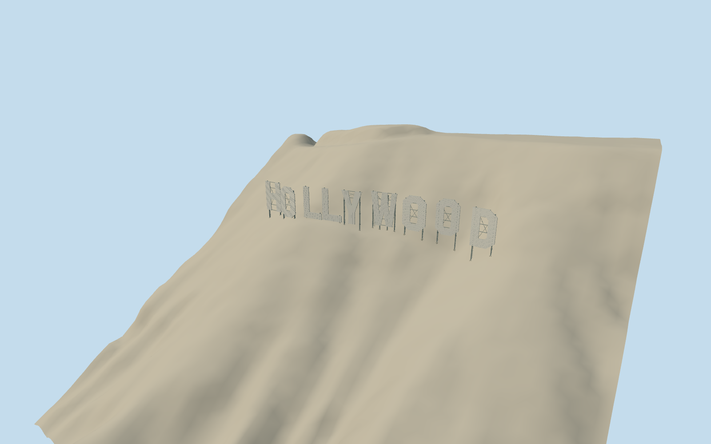

# Hollywood Sign

Nine custom faceted white metal letter panels on individually mapped alignments, terrain-specific feet, twenty steel support posts, rear girts, bracing, ladders and restrained corrugated surfaces.

Authoring state: **review-in-qa.json**. Current completion evidence is in [qa.json](qa.json) and the [local 100 ledger](../../../../qualla-structures/batches/PROGRESS.md).

- [Hollywood Sign](https://qualla.com/hollywood-sign/)

Started with cleared Qualla imagery. Current support construction uses the exact inspected Blake Everett CC0 rear original; older attribution-licensed or additionally restricted imagery is excluded as a current control. Individual OSM letter lines and source ground retained. Not an engineering survey.

Post tops and girt lengths follow letter profiles. The L framework has separate tall-stem and low-foot braces instead of a full rectangle beyond the panel. Member sections, attachment details and hidden engineering remain approximate.

Letter height is 13.716 m (45 ft). The Trust booklet reports 450 ft overall length, while mapped endpoints span about 105 m; mapped positions are retained and this discrepancy remains unresolved.

First O and second L widths are adjusted from short mapped lines to match the photographic proportions; all centers and angles remain mapped. Corrugation, beam sections, joints and ladders are simplified.

Photographic comparison sets approximate panel heights independently of USGS terrain-sampled feet. Native DEM resolution and vertical accuracy are unknown; exact ground contact remains host-terrain dependent.

Earlier HOLLYWOODLAND extension, mountaintop broadcast buildings, fences, surveillance equipment and landscape vegetation are outside this model. Reference photographs are not embedded or redistributed.

Build: `node packages/worldgen/scripts/generate-authored-places.mjs --ids=hollywood_sign`. Add `--check` to verify exact regeneration. 13508 triangles; 2 materials; no embedded photographs.
