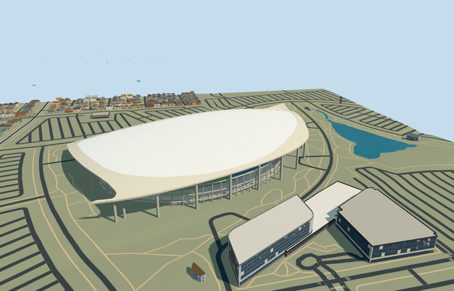

# N0710 — SoFi Stadium

Reviewed 2026-10-20 in one continuous author/build/inspect/fix round.

## Appearance

Inspected48 current portable/shared/medium-fi/native-site frames in one ordinary-picture/map/build/inspect/fix pass. Specific native swept fish-shaped pale canopy skirt/closed domed panel roof/visible underside and grid beams, branched perimeter columns, sunken blue-gray four-band stepped seating/concourses/suite bands/radial aisles, retaining walls/closed neutral football floor/linework/goals, genuinely hollow double-sided oval display and actual roof hangers, open major entry/stair-escalator groups, covered plaza landing and connected mapped theater exterior. Corrected accumulated far-outline simplification and mismatched roof-skin diagonals during construction, then checked every detail level. Accepted matched roof views have no earlier crossed-face shadow patches. Source-only portable views omit terrain to expose the complete buried retaining volume; separate shared/medium-fi fixtures apply the owned opening, and the native fixture proves map/grade behavior.

## Shared materials and browser levels

Five existing shared256-square graphs: concrete_plain, metal_painted, glass_frit_triangular, window_grid and fabric_canvas. Concrete supplies retaining/frame/plaza/theater surfaces; tinted paint supplies fascia/steel/seats/markings/goals/neutral displays; existing fritted glass supplies the pale gridded canopy panel approximation with continuous20m metric UVs; window-grid supplies closed suite/theater glazing; canvas grain explicitly approximates turf. The frit pattern is a reusable approximation, not a bespoke ETFE cushion atlas or transmission model. Palette roles merge into six near-level material draws. Each graph is read once and model eviction releases geometry. Six actual GLBs have zero embedded images/copied pixels, canonical shared refs, separate runtime POSITION/NORMAL streams and equal counted CPU/GPU geometry bytes. No new bitmap texture or building photo atlas.

| Level | Triangles | Bytes | Draws |
| --- | ---: | ---: | ---: |
| skyline | 836 | 84856 | 1 |
| district | 3878 | 375964 | 6 |
| street | 15728 | 1417188 | 6 |
| closeup | 39834 | 3518532 | 6 |

Inspected24 final medium-fi views at street/block/skyline distances, noon/late afternoon, Economy/High, neutral silhouette, matched levels and transitions. Review spacing6 places synthetic neighbors outside the large canopy; explicit close cameras show the bowl/display/entries/theater. Skyline retains the complete swept canopy, bowl/excavation closure, simplified colored bands and hollow display; district adds roof structure, glazing, goals/field lines and concourses; street/closeup add restrained rows/aisles, frame/roof grids and theater/entry detail. Initial skyline plus district460820bytes. Synthetic context establishes appearance, not geographic accuracy; physical ordinary-laptop/phone and dense-city timings remain pending. Levels836/3878/15728/39834 triangles; at most six draws.

## Approximate map fit

Retained exact-QID OSMway860635712/native stadium part35185232724544 identifies Q19520501 and the305.246x235.983m bowl. Own anchor-118.339007438,33.95340206/global heading0/native east-south; internal X[.454907200,.890538848]/Z[-.890538848,.454907200] fixes field/canopy direction. Native canopy52776574358422, connected parent35185120879153, roof parts35185232724542/543 and theater35185335800999 define the567.095x300.670m complete canopy/plaza/theater plan. The older reference point does not control fit. Fine row/doorway/hanger allocation retains20degree/2m approximation. Only these six corresponding components are replaced. All329 independent resident inputs among335 originals (1055 wider records), original6m terrain samples/native road inputs and27053.206978307055m2 water remain unchanged. A numerical canopy-parent remainder1.2789769243681803e-11m2 has no visible shell; loaded record count330. A bounded opening within90percent of the stadium body exposes the authored closed sunken floor/retaining walls, while outside ground and all water remain intact. The opening activates only on successful load; failure leaves native ground and335 original buildings, and all four levels unload with restored ground/water and zero live model geometry. No lake, outside office, parking or whole-site platform is modeled.

## Limits

Original medium-fi exterior and selected visible bowl/concourse detail follow five actually viewed ordinary2020/2021/2022 aerial/facade/concourse/bowl pictures. No qualified heights are retained: native stadium26m/theater11m are unqualified. Field-25m relative to mean native rim grade, four seating bands-23..-7/-4..5/8..14/17..27m, concourse6.5m, theater11m and curved canopy14..55m are picture-led visualization allocations. Mean rim datum is1.811707m above the37.584715m raw anchor sample. Exact excavation depth, ETFE transmission/cushion pattern, later roof illumination/equipment, seat/column/row inventory and fine reverse-facing details are not surveyed. Shared frit and canvas textures explicitly approximate panel finish and turf. Neutral109.728x48.768m football configuration excludes changing team artwork and painted numbers. No furnished service/theater interior, copied sponsor/live-screen text/photo atlas, crowd/event setup, neighboring NFL offices/parking/lake or whole-site reconstruction. Coarse terrain contacts are not surveyed foundations/drainage/flood measurements.

## Selected checks

Six Khronos files: zero errors/warnings.1553 actual mesh/material/contact checks; 48 current inspected views. Scene validation/sim30 and strict selected medium-fi audit pass. Source/runtime/LOD hashes and material bindings verified.

Rebuild: node packages/worldgen/scripts/generate-additional-landmarks.mjs --ids=N0710; node packages/worldgen/scripts/import-next-1000-models.mjs --ids=N0710; node packages/tooling/scripts/generate-landmark-lods.mjs --ids=N0710 --force.

Source: sha256:02c15fc85159d6965be3840e3e0f668231273c0618f26318af334da71c3770d6

Runtime: sha256:36d11fde4da98524b25507bafc422d2482feaa7623a500d6ed939e84ad47cb78

Input: sha256:77aa3ba386c5195b8152d52c88da008fda95586a74ee974bc6b14b01c8de055d

## Viewed ordinary pictures

https://commons.wikimedia.org/wiki/File:Aerial_view_of_SoFi_Stadium_(July_2022).jpg — Benoît Prieur; CC0-1.0. Viewed only; no pixels copied.

https://commons.wikimedia.org/wiki/File:SoFi_Stadium_East_facade.jpg — Redspork02; CC-BY-SA-4.0. Viewed only; no pixels copied.

https://commons.wikimedia.org/wiki/File:SoFi_Stadium_2022.jpg — PontiacAurora; CC-BY-SA-4.0. Viewed only; no pixels copied.

https://commons.wikimedia.org/wiki/File:SoFi_Stadium_(Los_Angeles,_USA).jpg — Thank You (21 Millions+) views; CC-BY-2.0. Viewed only; no pixels copied.

https://commons.wikimedia.org/wiki/File:Sofi_stadium_inside.jpg — DevvvyDevvv; CC-BY-3.0. Viewed only; no pixels copied.
