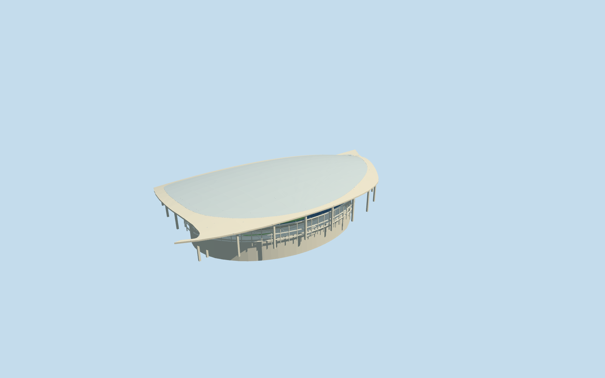

# SoFi Stadium

Specific SoFi Stadium connected canopy complex: native swept fish-shaped pale rim and closed gently domed ETFE-panel roof, visible underside/grid beams/branched perimeter columns, sunken blue-gray stepped bowl/four seating bands/suites/radial aisles, retaining walls/closed football floor/neutral linework/goals, hollow double-sided oval suspended display and hangers, open concourses/major entries/stair-escalator groups, covered plaza and attached mapped theater exterior. Five existing shared concrete/paint/fritted-glass/window-grid/canvas graphs. No copied team/sponsor/live-screen text, crowd/event setup, furnished service/theater interior, neighboring NFL office, parking/lake mesh or whole-site slab.

## Evidence and reconstruction

Published dimensions and reconstructed details are separated in spec.json. Primary references:

- [Reference](https://commons.wikimedia.org/wiki/File:Aerial_view_of_SoFi_Stadium_(July_2022).jpg)
- [Reference](https://commons.wikimedia.org/wiki/File:SoFi_Stadium_East_facade.jpg)
- [Reference](https://commons.wikimedia.org/wiki/File:SoFi_Stadium_2022.jpg)
- [Reference](https://commons.wikimedia.org/wiki/File:SoFi_Stadium_(Los_Angeles,_USA).jpg)
- [Reference](https://commons.wikimedia.org/wiki/File:Sofi_stadium_inside.jpg)

Specific SoFi Stadium connected canopy complex: native swept fish-shaped pale rim and closed gently domed ETFE-panel roof, visible underside/grid beams/branched perimeter columns, sunken blue-gray stepped bowl/four seating bands/suites/radial aisles, retaining walls/closed football floor/neutral linework/goals, hollow double-sided oval suspended display and hangers, open concourses/major entries/stair-escalator groups, covered plaza and attached mapped theater exterior. Five existing shared concrete/paint/fritted-glass/window-grid/canvas graphs. No copied team/sponsor/live-screen text, crowd/event setup, furnished service/theater interior, neighboring NFL office, parking/lake mesh or whole-site slab.

## Model and axes

39,834 triangles; 119,502 vertices; 6 material groups; 4,783,992 bytes. Native bounds: -149.654, -25.188, -205.737 to 292.440, 56.791, 268.060. Source hash: `sha256:02c15fc85159d6965be3840e3e0f668231273c0618f26318af334da71c3770d6`.

{"x":"east","y":"up","z":"south"}

The geographic proposal uses exact-QID OpenStreetMap evidence. Map-derived orientation and estimated architectural details require real-site visual review; preview eligibility is distinct from geographic/fidelity approval. Map attribution: © OpenStreetMap contributors, ODbL-1.0.

## Reproduce

Run `node packages/worldgen/scripts/generate-additional-landmarks.mjs --ids=N0710` (or add `--check`). The generator preserves manually edited masters by checking their baseline hashes. Import through the standard authored-model workflow with optimization disabled; then capture all QA cameras, including shared-surface views.

## Pending work

- Specific SoFi Stadium connected canopy complex: native swept fish-shaped pale rim and closed gently domed ETFE-panel roof, visible underside/grid beams/branched perimeter columns, sunken blue-gray stepped bowl/four seating bands/suites/radial aisles, retaining walls/closed football floor/neutral linework/goals, hollow double-sided oval suspended display and hangers, open concourses/major entries/stair-escalator groups, covered plaza and attached mapped theater exterior. Five existing shared concrete/paint/fritted-glass/window-grid/canvas graphs. No copied team/sponsor/live-screen text, crowd/event setup, furnished service/theater interior, neighboring NFL office, parking/lake mesh or whole-site slab.
- Retained exact-QID OSMway860635712/native stadium part35185232724544 identifies Q19520501 and the305.246x235.983m bowl. Own anchor-118.339007438,33.95340206/global heading0/native east-south; internal X[0.45490719973396315,0.8905388479062574]/Z[-0.8905388479062574,0.45490719973396315] follows the mapped field axis. Native canopy52776574358422, connected parent35185120879153, roof parts35185232724542/543 and theater35185335800999 control the roughly567.095x300.670m complete canopy/plaza/theater extent. The older reference point is not the bowl centre. Exact plan geometry is retained; fine doorway/row/column/hanger allocation retains20degree/2m approximation.
- No qualified architectural heights are retained. Native stadium26m and theater11m values are unqualified. Picture-led model uses field-25m relative to mean native rim grade, four seating bands-23..-7/-4..5/8..14/17..27m, concourse6.5m, theater11m and a curved canopy14..55m. These are visualization allocations, not measured excavation, roof, chair counts or as-built surveys. Domed panel skin uses an opaque diffuse approximation to ETFE; exact optical transmission, cushion seams, changing roof illumination and hidden service/equipment inventory are not simulated. Standard109.728x48.768m football rectangle is a neutral configuration.
- Original6m Mapzen sample grid, native roads/water and independent surroundings remain unchanged. Replace only six mapped connected canopy/bowl/theater components. A bounded opening inside90percent of the stadium body exposes authored closed sunken floor and retaining walls; no plaza/lake/whole-site terrain removal. Ground opening activates only with successfully loaded model, restores on failure/unload, and does not change source elevation samples. Perimeter supports and entry approaches meet coarse native grade independently; contacts/excavation are approximate, not surveyed drainage/flood or foundations.
- No qualified architectural heights are retained. Native stadium26m and theater11m values are unqualified. Picture-led model uses field-25m relative to mean native rim grade, four seating bands-23..-7/-4..5/8..14/17..27m, concourse6.5m, theater11m and a curved canopy14..55m. These are visualization allocations, not measured excavation, roof, chair counts or as-built surveys. Domed panel skin uses an opaque diffuse approximation to ETFE; exact optical transmission, cushion seams, changing roof illumination and hidden service/equipment inventory are not simulated. Standard109.728x48.768m football rectangle is a neutral configuration.

This bundle follows the medium-fi standard. Medium-fi appearance and geographic fit are reviewed separately. Hash-bound visual acceptance is recorded separately after capture inspection.
