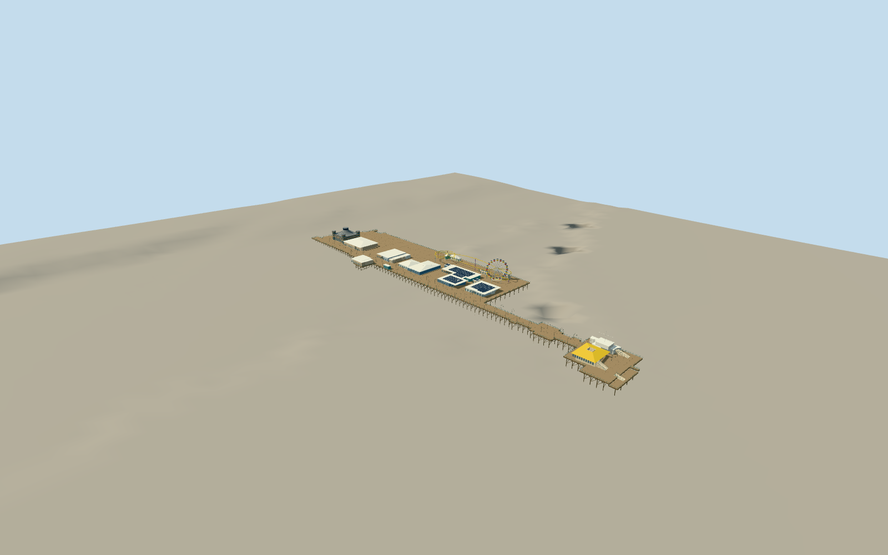

# Santa Monica Pier

Combined mapped timber pier and open pile frames/teal rails, broad shore platform and narrow municipal neck/wide head. Peach/blue Looff Hippodrome with seven arched bays, paired upper windows/three octagonal towers, swept tent roof and ventilated cupola. Static white Pacific Wheel with20 red/yellow open gondolas, yellow twin-helix West Coaster, integral roof masses and yellow-roof head restaurant/harbor office. No ride animation or city.

Authoring state: **review-in-qa.json**. Current completion evidence is in [qa.json](qa.json) and the [local 100 ledger](../../../../qualla-structures/batches/PROGRESS.md).

- [Santa Monica Pier](https://qualla.com/santa-monica-pier/)

Selected surviving2005–2025 exterior; current post2008 wheel and2021 stripped carousel roof control era. No original onion dome/crenellations/lost attractions, ride simulation, people/cars/boats, beach or surrounding city.

Native map footprint/orientation retained. Pile stations, fine facades/hidden sides/roof profiles and coaster chainages/heights are original proportional estimates, not a scan or engineering model. Minor park kiosks and rides simplified into main roof masses.

Independent coastal terrain remains unchanged.17m review grid/approximately4m source pixels are not surveyed marine levels. Dry reference5.706m and deck3m are bounded authoring pose; full pier bridge/raised road approach beyond own deck excluded.

Operator85ft size used for approximately26m overall wheel; conflicting130ft marketing phrase not interpreted as wheel diameter or tall pedestal. Twenty gondolas and open truss frame modeled statically without LED pixel fixtures.

No reference photograph pixels or generated bitmap textures embedded. Shared metric material graphs and native palette colors only; no interior carousel machinery.

Build: `node packages/worldgen/scripts/generate-authored-places.mjs --ids=santa_monica_pier`. Add `--check` to verify exact regeneration. 63947 triangles; 6 materials; no embedded photographs.
