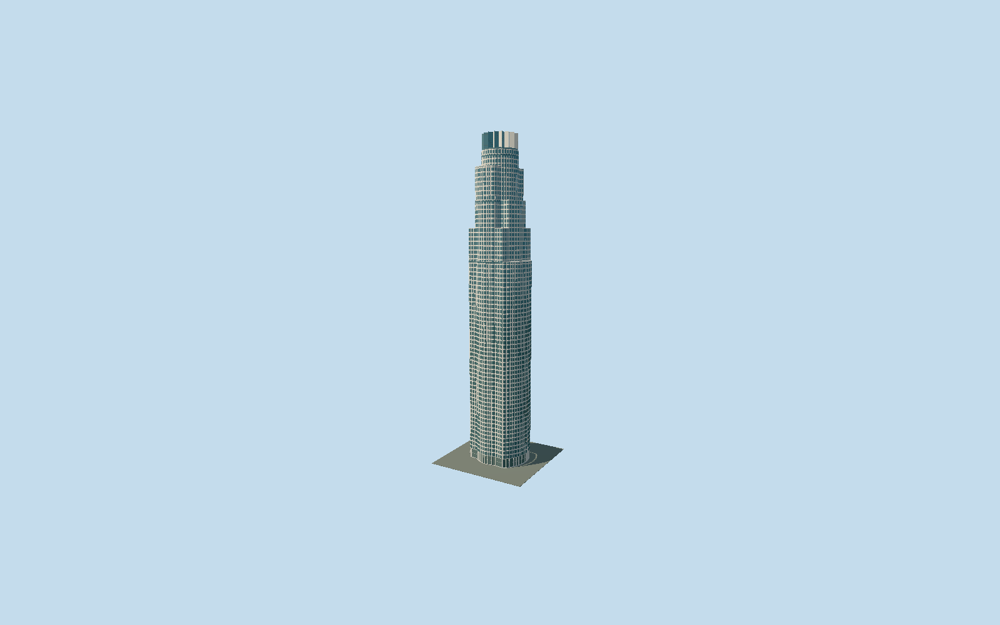

# U.S. Bank Tower

Los Angeles granite-and-glass tower with mapped concentric/orthogonal setbacks, triangular window bays, folded stone/glass crown, landing roof and renovated lobby.

## Evidence and reconstruction

Published dimensions and reconstructed details are separated in spec.json. Primary references:

- [Reference](https://www.pcf-p.com/projects/us-bank-tower-formerly-library-tower/)
- [Reference](https://www.silversteinproperties.com/portfolio-properties/us-bank-tower)
- [Reference](https://www.skyscrapercenter.com/building/id/445)
- [Reference](https://www.openstreetmap.org/way/23973401)

No third-party geometry, photograph or bitmap texture is embedded. Shared surface graphs come from the central library; vertex tints carry model colors. Glazing uses PBR materials; transparent surfaces are declared per model.

## Model and axes

39,679 triangles; 118,023 vertices; 4 material groups; 4,727,812 bytes. Native bounds: -30.497, 0.000, -24.651 to 29.943, 310.300, 24.616. Source hash: `sha256:c8b0e3c500e25ca582fb537bdea1c1bac96c999156840976c27f15cb4ef4a29a`.

{"up":"+Y","longitudinal":"+X northeast","front":"+Z southeast","origin":"Ground-level mapped center at lower Fifth Street entrance datum"}

Fresh OSM API on 2026-10-10 confirms unchanged exact Q57900 whole outline 23973401 and eleven independent mapped tower parts. Signed heading 1.086317737338 retained: native +X northeast, +Z southeast. Lower Fifth Street entrance faces southwest on -X toward the library. Different circular and orthogonal setbacks retain their mapped signs; crown is centered on mapped highest part 495115500. Ground Y=0 is lower entry datum. Approximate mapped stages at 195/225/250/280/295 m support the architect isometric setback sequence; they are not surveyed floor sections. Accept 2 m footprint / 1 degree reconstruction allowance, automatic replacement disabled. Hill steps, terrain slope and exact doorway thresholds are unmeasured.

## Reproduce

Run `node packages/worldgen/scripts/generate-signature-towers.mjs --ids=us_bank_tower` (or add `--check`). The generator preserves manually edited masters by checking their baseline hashes. Import through the standard authored-model workflow with optimization disabled; then capture all QA cameras, including shared-surface views.

## Pending work

- Original 130716-triangle, 15408960-byte master remains exactly reproducible from the unchanged world-tower recipe. Reviewed source and four browser levels preserve eleven mapped circular/orthogonal volumes, all setbacks, sixteen folded crown bays, glazed collar, closed circular landing roof and renewed ground lobby. Street/close-up retain reconstructed projecting triangular window profiles and long granite bands/piers; district flattens window projections and aggregates floors, skyline averages stone/glass coverage. Published 310.3 m tip and owner 30 ft (9.144 m) lobby follow current primary descriptions. Individual setback heights are approximate map data; architect isometric corroborates the ordering rather than survey dimensions. Owner/CVU count 72 stories while architect calls it 73; CVU completion 1990 differs from owner 1989. Crown phase/radii, bay spacing/projection, rail and canopy details remain reconstructions. Entrance canopy repair includes upward-facing opaque surfaces so it is visible from above; no interior transparency layer. Three shared 256 px graphs, zero embedded images. Tenant/roof lettering, flagpole and service furniture, interiors, separate Bunker Hill Steps/plaza landscape, parking and local sloped terrain are excluded. Native shaft allowances 1.5 / 0.75 / 0.3 / 0.1 m exclude omitted fine joints/reveals and distant canopy. No physical-device performance or surveyed grade claim. Close-up compresses the original 0.13 m window inset to 0.025 m, retaining the projecting bay peak and vertical reveals. Horizontal reveals merge into a continuous backing; street omits the shallow vertical reveals and aggregates three floor rows. These fine recess simplifications do not remove the main folded bay profile.

This bundle follows the medium-fi standard. Medium-fi appearance and geographic fit are reviewed separately. Hash-bound visual acceptance is recorded separately after capture inspection.
