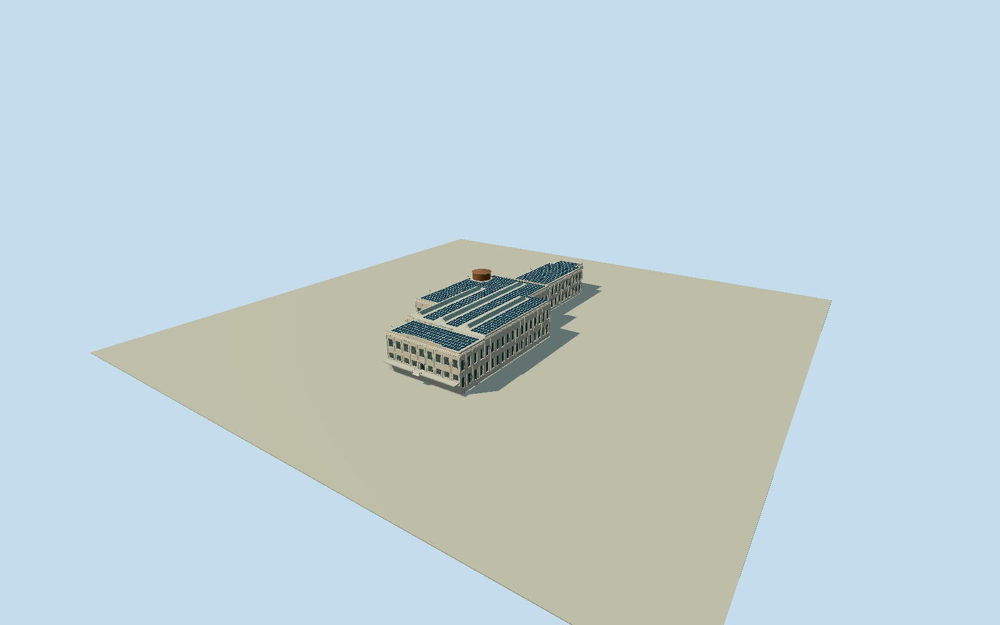

# Alcatraz Federal Penitentiary

Native principal prison exterior with staggered cellhouse wings, attached dining/kitchen and lower southeast administration frontage; nine-bay central arched entrance, two tiers of large recessed metal-grid windows over smaller base lights, plain concrete pilasters, rusticated lower walls, stepped cornices/parapets and narrow roof rods. Three long gabled glazed roof monitors, later solar-panel rows and an integral weathered cylindrical roof cistern with shallow conical cover. Short front entry apron and steps; separate lighthouse, detached cistern terrace, island guard towers/barracks and ruins excluded.

Authoring state: **review-in-qa.json**. Current completion evidence is in [qa.json](qa.json) and the [local 100 ledger](../../../../qualla-structures/batches/PROGRESS.md).

- [Alcatraz Federal Penitentiary](https://qualla.com/alcatraz-federal-penitentiary/)
- [Alcatraz Federal Penitentiary](https://qualla.com/#list/9q8z/alcatraz-federal-penitentiary-wp)

Plan is native map geometry with a documented sub-decimetre dining-junction seam. Heights, floors, window sizes, roof monitors, solar-panel layout and roof cistern proportions are photographic estimates, not measured survey elevations.

Later solar array is represented from the inspected official DOE roof photo; module count and maintenance/replacement state are not certified. Fine weathering, armorial relief and inscriptions are generalized.

Main prison exterior only. Cell interiors, subterranean Citadel, recreation yard/guard houses, separate front vaulted cistern terrace, lighthouse and island-wide ruins/barracks remain outside scope. No navigable collision or architectural conservation claim.

Original USGS field remains unchanged. One-metre source and sampling do not certify ground classification at paving/hidden foundations or default coarse Earth terrain compatibility.

Build: `node packages/worldgen/scripts/generate-authored-places.mjs --ids=alcatraz_federal_penitentiary`. Add `--check` to verify exact regeneration. 42153 triangles; 4 materials; no embedded photographs.
