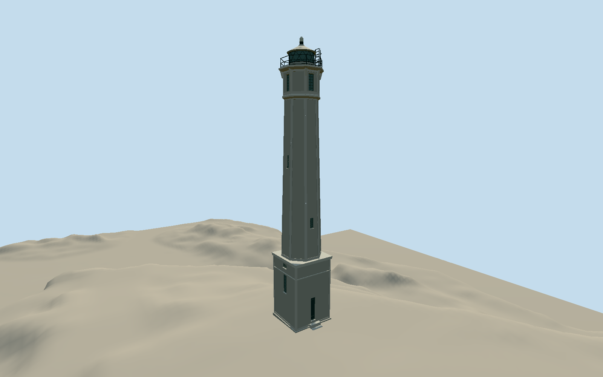

# Alcatraz Island Lighthouse

1909 natural-gray concrete lighthouse with tall square sash/door base, tapering octagonal long recessed-panel shaft, small gridded windows, octagonal watchroom with alternating sash/blind panels, corbelled gallery and open triple iron rail, cylindrical helical-glazed lantern, shallow conical roof/current beacon and short caged service ladder. Narrow own footing and three entrance treads only; separate prison/cistern and ruined residences excluded.

Authoring state: **review-in-qa.json**. Current completion evidence is in [qa.json](qa.json) and the [local 100 ledger](../../../../qualla-structures/batches/PROGRESS.md).

- [Alcatraz Island Lighthouse](https://qualla.com/alcatraz-island-lighthouse/)

Historic1910 inventory controls4.191m square base,3.2512m parapet width,2.322068m circular lantern glass diameter and.9017m glazed height. Full current base-to-beacon envelope approximately27.49m follows historic90ft2.25in ventilator height and dated photos. USCG84ft/NPS95ft disagree; endpoints/epochs unresolved. This is an approximate photographic exterior, not a measured current survey.

Five actual full local originals/40 thumbnails inspected. Sparse unseen rear shaft/base openings and door bearing are conservative interpretations. Eleven historic varied windows/two doors do not establish their exact present positions. Fine concrete damage and ironwork are generalized; no original photo pixels used as textures.

Independent original USGS ground remains unchanged. One-metre source/sampling cannot certify hidden foundations or current paving classification. Default coarse Earth terrain compatibility and whole-island scenery are not certified. Separate prison, residences/ruins, cistern, fences and lamps excluded.

Build: `node packages/worldgen/scripts/generate-authored-places.mjs --ids=alcatraz_island_lighthouse`. Add `--check` to verify exact regeneration. 7354 triangles; 3 materials; no embedded photographs.
