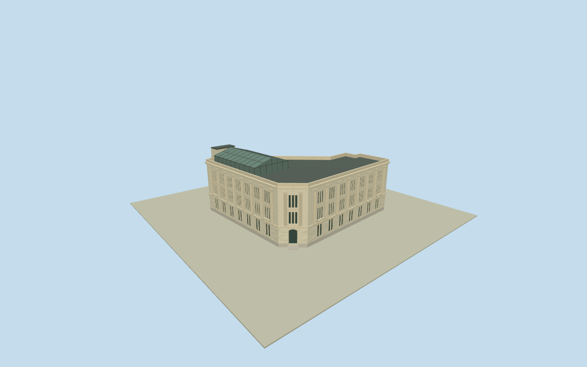

# Bethlehem Steel Administration Building

Whole Building101/Pier70 Bethlehem Steel Administration Building: native20-control enduring1917ClassicalRevival Lshell and attached centralatrium, beveledarchedentry/granitesteps/raisedrusticatedbase, pairedlower and tripleuppersashtransoms/realrecesses/two-storyflutedpilasters/spandrels/stringcourse/balustradedsills/entablature/cornice/parapet/partialpenthouse/steelglassatrium and text-supportedrooftopconservatory. Exact cleared published creator-ownPDself exterior first/only, original bounded current hidden/newroofsections/census/finish, not wholeindustrialdistrict or copiedimage.

Authoring state: **review-in-qa.json**. Current completion evidence is in [qa.json](qa.json) and the [completion ledger](../../../../qualla-structures/batches/qualla-002.PROGRESS.md).

- [Pier 70, San Francisco](https://qualla.com/pier-70-san-francisco/)

Actual whole current20-control native Building101/attachedintrinsicatrium envelope, nativebboxanchor/heading0 fixed before original independent field/floor/sections/geometry. Distinct adjacent industrial buildings and historic property excluded.

Whole current20-control Building101 outline retained in physical foundation. Current internal centralglassatrium projection nodes10901205601/604/605/603/602 decomposed from enduring1917 Lshell along original internaldiagonal0-to6; everywhole20XZ vertex remains native, no sitepropertybox. Original bounded roof/conservatory/penthouse subdivisions and glazing profiles from exactpublished2007shell pluscurrentoperator/architect text, not surveyed roofpartpolygons. Beveledentry two nearlycollinear nativeedge segments combined for doorway surface, all exactvertices retained in foundation. Streetwindowbay7+7andcornertriple, rearwindow and flutedpilastercensus originalphoto-boundedestimates. Basementsubbasement/innerdecor/brandfurniture excluded; no entirePier70oradjacentindustrialbuildings.

Original independent256m129x12916641samples/fourrawtiles/SW13.1868m providerrelative datum/native20controlbboxanchor/heading0 frozen before once-only beveledentryexteriorfloor-4.0395m/allverticalsections/geometry. Nativeheight19m usedforparapet; Port72ft=21.9456m supports partialhistoricalroofpenthouse. Originalphoto/text-bounded plinth1.1/string6.05–6.5/twoupperwindowbands7.1–10.85and12–15.75/pilasters6.5–16.8/entablature17.65/cornice18.1/roof17.7/parapet19m; currentnativeatrium8.2eave10.2ridge and text-supportedrooftopconservatory20.5eave22.5ridge originalestimates. Sourcecounts/corniceprofile/flutes/hiddenjoins/modernroofsections/currentfinish and exactcontactunverified, notsurvey. No later floor/field/sections/anchorretune/fitting/flattening/reacquire/reframe/raising.

One exact cleared published2007creator-ownPDself nativeoriginal first/only. Primaryowner/operator/architect text supplies dimensions/restoration/newglassatrium/conservatoryfacts; protectedmodernimages/plans not adopted. No sourcepixels embedded, oldboards/graffiti/furniture/brands/people/vehicles/wires/fences/landscape excluded.

Currentwhole20nativefootprint and enduring1917shell. New/hiddenatrium/conservatory/penthouseroofprofiles/supportcensus/cornice/flutes/rearwindows/fineornament/currentfinish are originalboundedestimates, not measuredsections or precise currentconditions. Actual7+7baystreetfacades photo-bounded, not nativewindowplan. Opaque representative glazing intentionallysimplifiestransmission/interiors.

Originalindependent256m129field/fourrawtiles/floor/sections fixed beforegeometry, nofitting/flattening/reacquire/reframe/lateraise. Exactentry/basement/foundation/streetcontact unverified, preview/replacementfalse. Flatgroundandcontextneighborhouses are fixtures.

Build: `node content/worldgen/source/places/9q/9q8/bethlehem_steel_administration_building/models/generate-bethlehem-steel-administration-building.mjs`. Add `--check` to verify exact regeneration. 28284 triangles; 5 materials; no embedded photographs.
