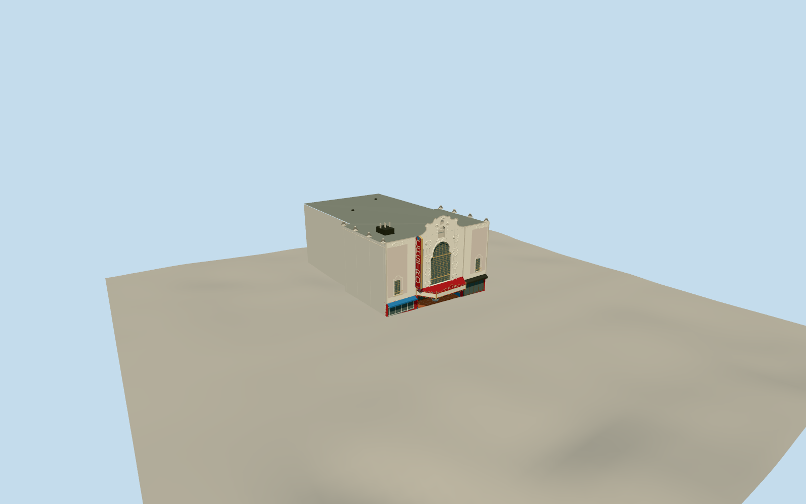

# Castro Theatre

Dated2008–2016Castro Theatre, with2022exterior arcade layout: broad native concrete front/narrow rear auditorium/shallow roof, three-part white/buff Spanish Colonial facade with tall arched gridded light, scroll parapet/shell niche/oval/relief cartouches/abstract foliage, small flanking windows/balconies and blind pink panels. Native trapezoid1937marquee with red-gold-blue zigzags/hexagons/curved CASTROcrest/static pale boards and bulb soffit. Red double-sided CASTROblade, white channel letters/gold tube strokes/blue edge scrolls/crown/diamond, open attachment brackets. Deep tiled arcade, five glazed oak door pairs/three plain northwall poster recesses/faceted island booth; same-building shop glazing/blue north and dark south awnings. Sloping frontage/unchanged terrain, no neighboring structures or actual ads/artwork/interior.

Authoring state: **review-in-qa.json**. Current completion evidence is in [qa.json](qa.json) and the [local 100 ledger](../../../../qualla-structures/batches/PROGRESS.md).

- [Castro Theatre](https://qualla.com/castro-theatre/)

Dated2008–2016 exterior/sign/marquee from local corpus. Post-renovation2026 interior/finish changes not claimed; official current calendar only confirms operating identity.

Native generalized five building/part contours retained independently, including actual trapezoid marquee and blade projection. Heights/roof crown/fine ornament/hidden thresholds are proportional estimates with primary nominal sign/marquee dimensions, not engineering drawings.

No neighboring buildings/coffee brand lettering or event ads/poster artwork/roof graffiti/interior/patrons/vehicles/trees/flag/streetlamps or photo pixels. Same-building shop openings/awnings remain part of envelope.

Independent terrain acquisition precedes floor/foundation geometry; no terrain flattening or model-fitted heights.

Facade17m/raised center20.6m/shallow roof16.65–17.1m are proportional map/photo estimates. Blade12.2m tall/canopy3mabovedatum(~3.66mabovefrontgrade) and4mprojection/9mfront use primary nominal measurements plus native plan. Fine sculpture represented by original abstract cartouches/leaves rather than copied artwork.

Arcade walkway/door thresholds reflect independently sampled broad terrain slope, not a threshold survey; smooth actual paving/interior floor relationship remains approximate. Five door-pair bottoms follow local grade while upper fanlights form one cornice line. Glazing opaque for library, tube colors do not simulate flashing neon.2022foyer photographs supplement2008–2016exterior; post-renovation2026changes not claimed.

Build: `node packages/worldgen/scripts/generate-authored-places.mjs --ids=castro_theatre`. Add `--check` to verify exact regeneration. 31920 triangles; 8 materials; no embedded photographs.
