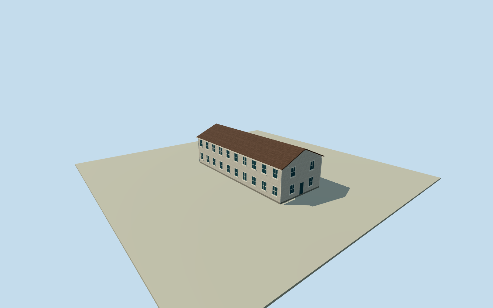

# Fort Cronkhite Building 1064

Complete independently named programme office in FortCronkhite Building1064: whole original native four-corner body, two occupied levels, all roof slopes/gables, closed rear/ends and estimated office/barracks-family windows, doors and exterior access. Actual programme publications establish this building, independently of the HawkHill field-counting location. Adjacent fort buildings and dispersed outdoor field sites remain separate. Original named outline/centroid/edge-derived facing retained. The broad public-domain NPS historical view supplies building-family form only. Individual heights, roof pitch/profile/color, opening/access census and precise2021appearance remain explicit estimates, not a blueprint or photographic match. Nominal10m horizontal/2m height-components/10degree facing allowances are not measured error bounds. Whole actual office building exterior, not an observatory dome or a summit military structure proxy. Original programme address and named native building corroborate Building1064. The2021director account describes going downstairs in the office; two occupied levels are supported, but individual section heights are not measured. Whole original four-corner numerical body retained by bilinear construction. Broad NPS historical photograph supplies standardized wood-frame gable/barracks family only; no precise image-to1064identification,2021condition or photographic accuracy claimed. Fullbody/gables/two roof slopes, two rows of windows, closed entry/rear/ends, external stair/landing and foundations are modeled. Original estimated sections after own field: floor0.45m, upper floor3.70m, eaves6.55m, ridge9.00m, foundation-3m; roof thickness0.16m. Roof slope/overhang, ten side windows per floor, two end-window bays per floor, one estimated exterior stair with18treads, all access details, trim/color/shingle finish, precise2021condition and hidden faces are unverified estimates. No photographic texture or logo/art copied. Nominal10m horizontal/2m height-component/10degree facing allowances are estimates, not measured error bounds. Current numerical outline is used for approximate2021registration; precise footprint continuity and historical vertical datum unverified. Own independent256m129x129 original source field and two raw tiles acquired before floor/mainsections. Frame/field/initial sections frozen; no mask, flattening, cutout, height fitting or relocation. Coarse local ground contact remains approximate. All four levels preserve whole original body/corners/gables/roof, two occupied levels, all estimated window volumes and external stair/landing. Near levels add surrounds/mullions/rail uprights/tread and trim details. Interior rooms, programme equipment and unrelated FortCronkhite buildings excluded. Separate accepted HawkHill site assets retained; this model represents the actual programme office. Historical approximate2021preview/currentWorldEligiblefalse.

Authoring state: **review-in-qa.json**. Current completion evidence is in [qa.json](qa.json) and the [completion ledger](../../../../qualla-structures/batches/qualla-002.PROGRESS.md).

- [Golden Gate Raptor Observatory](https://qualla.com/golden-gate-raptor-observatory/)

Complete independently named programme office in FortCronkhite Building1064: whole original native four-corner body, two occupied levels, all roof slopes/gables, closed rear/ends and estimated office/barracks-family windows, doors and exterior access. Actual programme publications establish this building, independently of the HawkHill field-counting location. Adjacent fort buildings and dispersed outdoor field sites remain separate. Original named outline/centroid/edge-derived facing retained. The broad public-domain NPS historical view supplies building-family form only. Individual heights, roof pitch/profile/color, opening/access census and precise2021appearance remain explicit estimates, not a blueprint or photographic match. Nominal10m horizontal/2m height-components/10degree facing allowances are not measured error bounds.

Whole actual office building exterior, not an observatory dome or a summit military structure proxy. Original programme address and named native building corroborate Building1064. The2021director account describes going downstairs in the office; two occupied levels are supported, but individual section heights are not measured.

Whole original four-corner numerical body retained by bilinear construction. Broad NPS historical photograph supplies standardized wood-frame gable/barracks family only; no precise image-to1064identification,2021condition or photographic accuracy claimed. Fullbody/gables/two roof slopes, two rows of windows, closed entry/rear/ends, external stair/landing and foundations are modeled.

Original estimated sections after own field: floor0.45m, upper floor3.70m, eaves6.55m, ridge9.00m, foundation-3m; roof thickness0.16m. Roof slope/overhang, ten side windows per floor, two end-window bays per floor, one estimated exterior stair with18treads, all access details, trim/color/shingle finish, precise2021condition and hidden faces are unverified estimates. No photographic texture or logo/art copied.

Nominal10m horizontal/2m height-component/10degree facing allowances are estimates, not measured error bounds. Current numerical outline is used for approximate2021registration; precise footprint continuity and historical vertical datum unverified.

Own independent256m129x129 original source field and two raw tiles acquired before floor/mainsections. Frame/field/initial sections frozen; no mask, flattening, cutout, height fitting or relocation. Coarse local ground contact remains approximate.

All four levels preserve whole original body/corners/gables/roof, two occupied levels, all estimated window volumes and external stair/landing. Near levels add surrounds/mullions/rail uprights/tread and trim details. Interior rooms, programme equipment and unrelated FortCronkhite buildings excluded. Separate accepted HawkHill site assets retained; this model represents the actual programme office. Historical approximate2021preview/currentWorldEligiblefalse.

Build: `node content/worldgen/source/places/9q/9q8/golden_gate_raptor_observatory/models/generate-house.mjs`. Add `--check` to verify exact regeneration. 5082 triangles; 5 materials; no embedded photographs.
