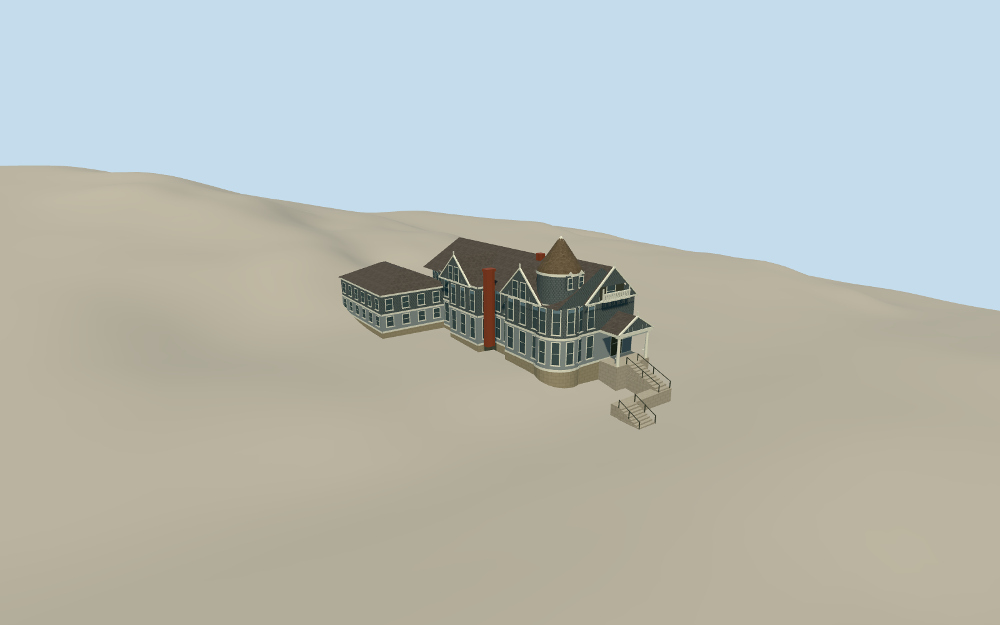

# Haas-Lilienthal House

The May 2015 Haas-Lilienthal House on Franklin Street, with its Queen Anne turret, shingled gables, entry stair, porch and attached 1929 guest wing.

Authoring state: **review-in-qa.json**. Current completion evidence is in [qa.json](qa.json) and the [completion ledger](../../../../qualla-structures/batches/qualla-003.PROGRESS.md).

- [Haas-Lilienthal House](https://qualla.com/haas-lilienthal-house/)

The original mapped envelope is the horizontal control. Tower cap and roof heights, bay widths, carved patterns, rear wing façade and rear roof are approximate. The model focuses on the May 2015 exterior and attached guest wing.

The original Terrarium field is unchanged. Exterior foundation exposure, two-run stair alignment and attachment to the sidewalk are approximate. The written survey establishes eight and ten risers.

The modern color references are the exact CC0 Daderot originals. The HABS east-front image supports form and trim. Interior contents and the lot boundary are outside scope.

Build: `node content/worldgen/source/places/9q/9q8/haas_lilienthal_house/models/generate-haas-lilienthal.mjs`. Add `--check` to verify exact regeneration. 3362 triangles; 6 materials; no embedded photographs.
