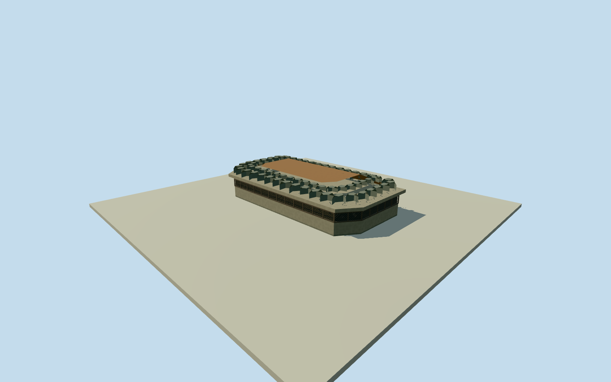

# Hawk Hill Battery Commander Station

Whole independent low concrete Battery Commander Station at the Hawk Hill summit: complete closed body, screened panoramic observation slit, projecting slab and intrinsic stone/earth camouflage roof. Adjacent elevated radar platform, north watch pad, trails, natural hill and separate lower casemates are excluded and remain separate models. This associated historic summit structure alone does not complete the GGRO observation facility. Original site context is native named Hawk Hill peak and summit access footway. Station coordinate [-122.498783,37.828419] and heading−pi/2 are explicit original estimates from broad cleared agency views, not surveyed body placement. All14x6.4m outline, wall/slit/roof sections, exact façade census, hidden rear/entry, stone arrangement, precise2013-to2025continuity and vertical tie remain estimated. Nominal25m horizontal/2m height/2m component/90degree facing allowances are estimates, not measured bounds. Dated approximate2013appearance; no2025new bridge or proposed building claimed. Complete independent station body, projecting reinforced-concrete roof apron, a continuous screened slit around panoramic front and chamfered end faces, rear closed wall/estimated closed entry, and intrinsic rubble/soil camouflage cover. No whole-hill terrain mesh, unrelated lower casemate, elevated radar platform or watch-pad proxy. All six-corner14x6.4m body plan, dimensions, facing, window census, rear detail, opening size, stone positions, exact2013condition/continuity and vertical tie are explicit original estimates. Initial floor0.25m, foundation-3m, slit bottom1.15m/top1.85m, roof soffit2.05m/top2.30m, stone/soil cap top3.20m.25m horizontal/2m height/component/90degree facing allowances are nominal estimates, not measured error bounds. Cleared original NPS2013aerial gives whole summit arrangement and station mass; original NPSNovember2025station photo shows concrete apron, dark screened panoramic opening and stone/earth cover. The newer photo supports broad form/material context, not exact2013appearance continuity. No exact2013capture date is certified beyond the source filename; dated2013visualization is approximate. Both exact image bytes, individual agency credits and explicit NPS public-domain policy are bound. Other credited design drawings, contractor report graphics/GoogleEarth backgrounds and interpretive-sign artwork remain unused. No photograph texture. Own original256m129x129 independent ground field and raw source tiles acquired before floor and main sections; frame, field, initial floor and sections frozen. No masking, flattening, cutout, finished-height fit, source-image fit or relocation of a mapped building. Approximate station-body coordinate was chosen as an original visual geographic estimate before its field. Native summit/footway remains context only, not a measured body footprint. Four complete authored levels retain whole body, screened opening, overhanging slab, closed rear and entire bounded stone/earth roof. Near levels add screen mullions/lattice, physical slit reveals, more individually modeled stones and rear door detail. Concealed internal rooms, drainage and interior equipment omitted. Historical approximate2013preview/currentWorldEligiblefalse. This associated station alone does not complete the GGRO facility.

Authoring state: **review-in-qa.json**. Current completion evidence is in [qa.json](qa.json) and the [completion ledger](../../../../qualla-structures/batches/qualla-002.PROGRESS.md).

- [Golden Gate Raptor Observatory](https://qualla.com/golden-gate-raptor-observatory/)

Whole independent low concrete Battery Commander Station at the Hawk Hill summit: complete closed body, screened panoramic observation slit, projecting slab and intrinsic stone/earth camouflage roof. Adjacent elevated radar platform, north watch pad, trails, natural hill and separate lower casemates are excluded and remain separate models. This associated historic summit structure alone does not complete the GGRO observation facility. Original site context is native named Hawk Hill peak and summit access footway. Station coordinate [-122.498783,37.828419] and heading−pi/2 are explicit original estimates from broad cleared agency views, not surveyed body placement. All14x6.4m outline, wall/slit/roof sections, exact façade census, hidden rear/entry, stone arrangement, precise2013-to2025continuity and vertical tie remain estimated. Nominal25m horizontal/2m height/2m component/90degree facing allowances are estimates, not measured bounds. Dated approximate2013appearance; no2025new bridge or proposed building claimed.

Complete independent station body, projecting reinforced-concrete roof apron, a continuous screened slit around panoramic front and chamfered end faces, rear closed wall/estimated closed entry, and intrinsic rubble/soil camouflage cover. No whole-hill terrain mesh, unrelated lower casemate, elevated radar platform or watch-pad proxy.

All six-corner14x6.4m body plan, dimensions, facing, window census, rear detail, opening size, stone positions, exact2013condition/continuity and vertical tie are explicit original estimates. Initial floor0.25m, foundation-3m, slit bottom1.15m/top1.85m, roof soffit2.05m/top2.30m, stone/soil cap top3.20m.25m horizontal/2m height/component/90degree facing allowances are nominal estimates, not measured error bounds.

Cleared original NPS2013aerial gives whole summit arrangement and station mass; original NPSNovember2025station photo shows concrete apron, dark screened panoramic opening and stone/earth cover. The newer photo supports broad form/material context, not exact2013appearance continuity. No exact2013capture date is certified beyond the source filename; dated2013visualization is approximate. Both exact image bytes, individual agency credits and explicit NPS public-domain policy are bound. Other credited design drawings, contractor report graphics/GoogleEarth backgrounds and interpretive-sign artwork remain unused. No photograph texture.

Own original256m129x129 independent ground field and raw source tiles acquired before floor and main sections; frame, field, initial floor and sections frozen. No masking, flattening, cutout, finished-height fit, source-image fit or relocation of a mapped building. Approximate station-body coordinate was chosen as an original visual geographic estimate before its field. Native summit/footway remains context only, not a measured body footprint.

Four complete authored levels retain whole body, screened opening, overhanging slab, closed rear and entire bounded stone/earth roof. Near levels add screen mullions/lattice, physical slit reveals, more individually modeled stones and rear door detail. Concealed internal rooms, drainage and interior equipment omitted. Historical approximate2013preview/currentWorldEligiblefalse. This associated station alone does not complete the GGRO facility.

Build: `node content/worldgen/source/places/9q/9q8/hawk_hill_battery_commander_station/models/generate-house.mjs`. Add `--check` to verify exact regeneration. 7174 triangles; 6 materials; no embedded photographs.
