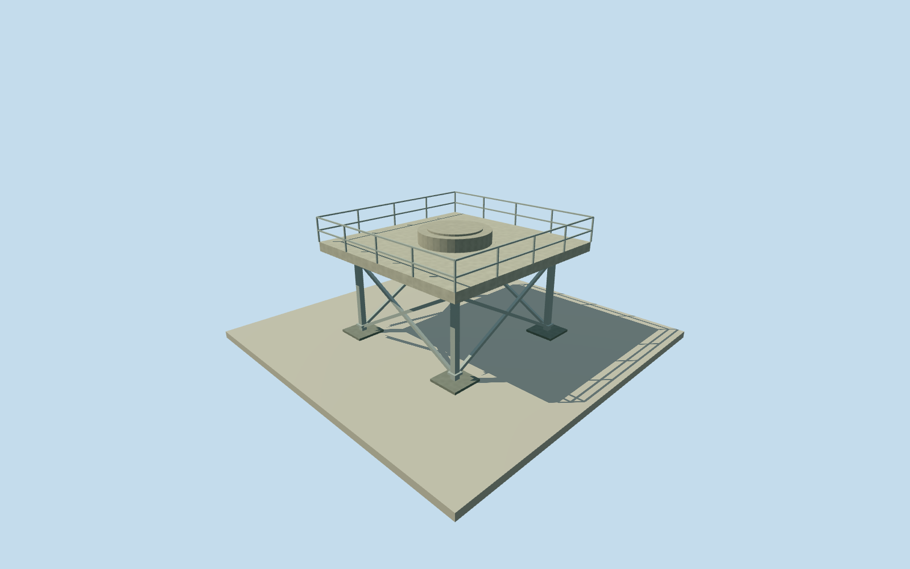

# Hawk Hill elevated radar platform

Whole independent elevated steel-supported Nike radar platform at Hawk Hill, including complete deck, four main legs, cross-bracing and central concrete radar footing. The Battery Commander Station, north watch pad, natural hill and lower gun casemates remain separate. No2025new access bridge is assigned to this approximate2013phase. Original summit/footway context fixes the site only. Platform coordinate [-122.499008,37.828423] and heading0 are explicit original approximate geographic estimates from the broad cleared NPS aerial arrangement, not surveyed body placement. All8x8m deck extent, deck/footing/rail/column dimensions, exact bracing, base arrangement, facing, precise2013condition and vertical tie remain original estimates. Nominal25m horizontal/3m height/component/90degree facing allowances are estimates, not measured error bounds. This platform alone does not complete the GGRO observation facility. Complete independent historical elevated radar platform: closed8x8m deck, four main columns, perimeter support girders, cross-bracing, central round concrete radar footing, estimated rail and separate column foundations. No antenna/radome, natural hill or adjacent station/watch-pad proxy. Approximate2013phase has no2025new accessible bridge. Initial foundation pads-2.5m..0.25m, support columns0.25m..3.90m, deck underside3.90m/top4.30m, central3.1m-diameter footing top4.85m, rail top5.35m. All size, heights, support/brace/rail arrangement, footing type/census and precise2013condition are original estimates from one coarse cleared aerial; none measured.25m horizontal/3m height/component/90degree facing allowances are nominal estimates, not measured bounds. One original NPS aerial, individually credited Frank Schmidt NPS without copyright symbol and bound to native official project page, explicit agency public-domain policy and original bytes. Qualla31families screened first.2013date follows original filename only and remains approximate. No other appearance photo, designer graphic, report map/GoogleEarth background or photo texture used. Official primary project text establishes elevated Nike SF87C platform identity, not its dimensions or2013rail geometry. Own independent256m129x129 original source field and raw tiles acquired before floor/main sections. Body coordinate/facing are original geographic estimates from broad agency summit arrangement and native peak/footway context, not surveyed body controls. Field, frame, initial floor and main sections frozen. No mask, flattening, cutout, fitting or repositioning after field. Coarse hilltop contact and exposed/hidden foundation portions remain approximate. All four authored levels retain whole deck, all main supports/cross-braces, central footing and estimated perimeter rail. Near levels add joint plates, beam flange cues and denser round footing. No internal radar equipment, unverified antenna, underground works or whole-site composite. Historical approximate2013preview/currentWorldEligiblefalse; full GGRO facility remains unfinished.

Authoring state: **review-in-qa.json**. Current completion evidence is in [qa.json](qa.json) and the [completion ledger](../../../../qualla-structures/batches/qualla-002.PROGRESS.md).

- [Golden Gate Raptor Observatory](https://qualla.com/golden-gate-raptor-observatory/)

Whole independent elevated steel-supported Nike radar platform at Hawk Hill, including complete deck, four main legs, cross-bracing and central concrete radar footing. The Battery Commander Station, north watch pad, natural hill and lower gun casemates remain separate. No2025new access bridge is assigned to this approximate2013phase. Original summit/footway context fixes the site only. Platform coordinate [-122.499008,37.828423] and heading0 are explicit original approximate geographic estimates from the broad cleared NPS aerial arrangement, not surveyed body placement. All8x8m deck extent, deck/footing/rail/column dimensions, exact bracing, base arrangement, facing, precise2013condition and vertical tie remain original estimates. Nominal25m horizontal/3m height/component/90degree facing allowances are estimates, not measured error bounds. This platform alone does not complete the GGRO observation facility.

Complete independent historical elevated radar platform: closed8x8m deck, four main columns, perimeter support girders, cross-bracing, central round concrete radar footing, estimated rail and separate column foundations. No antenna/radome, natural hill or adjacent station/watch-pad proxy. Approximate2013phase has no2025new accessible bridge.

Initial foundation pads-2.5m..0.25m, support columns0.25m..3.90m, deck underside3.90m/top4.30m, central3.1m-diameter footing top4.85m, rail top5.35m. All size, heights, support/brace/rail arrangement, footing type/census and precise2013condition are original estimates from one coarse cleared aerial; none measured.25m horizontal/3m height/component/90degree facing allowances are nominal estimates, not measured bounds.

One original NPS aerial, individually credited Frank Schmidt NPS without copyright symbol and bound to native official project page, explicit agency public-domain policy and original bytes. Qualla31families screened first.2013date follows original filename only and remains approximate. No other appearance photo, designer graphic, report map/GoogleEarth background or photo texture used. Official primary project text establishes elevated Nike SF87C platform identity, not its dimensions or2013rail geometry.

Own independent256m129x129 original source field and raw tiles acquired before floor/main sections. Body coordinate/facing are original geographic estimates from broad agency summit arrangement and native peak/footway context, not surveyed body controls. Field, frame, initial floor and main sections frozen. No mask, flattening, cutout, fitting or repositioning after field. Coarse hilltop contact and exposed/hidden foundation portions remain approximate.

All four authored levels retain whole deck, all main supports/cross-braces, central footing and estimated perimeter rail. Near levels add joint plates, beam flange cues and denser round footing. No internal radar equipment, unverified antenna, underground works or whole-site composite. Historical approximate2013preview/currentWorldEligiblefalse; full GGRO facility remains unfinished.

Build: `node content/worldgen/source/places/9q/9q8/hawk_hill_elevated_radar_platform/models/generate-house.mjs`. Add `--check` to verify exact regeneration. 980 triangles; 4 materials; no embedded photographs.
