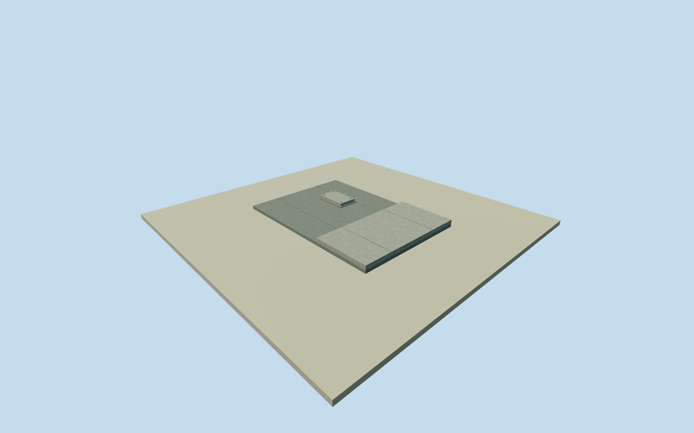

# Hawk Hill northern concrete platform

Whole separate northern concrete observation platform at Hawk Hill: complete low concrete deck and retaining body, stepped adjoining deck portion and small raised mounting plinth. Station and elevated radar deck remain separate. Exact programme identity as the named GGRO North Platform is not independently surveyed; this is the visually evidenced northern physical platform. Original coordinate [-122.498755,37.828704] and heading0 are visual estimates north of the native summit context. All10x7m plan, step, mounting-plinth dimensions, facing, precise2013condition and vertical tie are original estimates. Nominal25m horizontal/2m height/component/90degree facing allowances are not measured bounds. Original2013agency aerial supplies historical site appearance; March2025NPS path view supplies broad bare-concrete stepped-platform morphology, without a precise2013continuity claim. Construction fences, graffiti, equipment and nearby natural hill are excluded. This member alone does not complete the GGRO site. Complete northern low concrete platform body, adjoining raised deck portion and one small mounting plinth. All10x7m plan and component dimensions are original estimates. The underlying retaining body is closed, not a hollow facade. Original floor/deck top0.35m, adjoining portion top0.60m, small plinth top0.60m and foundation bottom-2.5m were chosen after independent field acquisition and before geometry. No actual height or footprint measurement is claimed. Two exact independently credited original NPS public-domain photographs: original2013aerial and March2025path view. The latter supplies broad material/stepped-platform morphology, not a certified2013appearance. Construction barriers/equipment, graffiti, interpretive graphics and programme tape markings are excluded. No photo textures. Qualla31families were screened first. Original location north of the native summit, facing and whole outline are visual geographic estimates. The native peak/footway are site context only. Exact identity as the programme report North Platform remains unverified. Nominal25m horizontal/2m height/component/90degree facing allowances are not measured bounds. Own independent256m129x129 original source field and two raw tiles were acquired before floor/main sections. Frame, field, floor and main sections are frozen; no flattening, mask, cutout, vertical fitting, relocation or source field replacement. Coarse hilltop contact and exposed/buried retaining portions remain approximate. All four authored levels preserve the whole low body, stepped deck and mounting plinth. Near levels add estimated concrete pour seams, plinth ledge and small fastening cues. No surrounding natural hill mesh, underground rooms or unrelated battery casemate. Approximate2013historical visualization/currentWorldEligiblefalse. Separate station/elevated radar assets are retained; full GGRO site remains unfinished.

Authoring state: **review-in-qa.json**. Current completion evidence is in [qa.json](qa.json) and the [completion ledger](../../../../qualla-structures/batches/qualla-002.PROGRESS.md).

- [Golden Gate Raptor Observatory](https://qualla.com/golden-gate-raptor-observatory/)

Whole separate northern concrete observation platform at Hawk Hill: complete low concrete deck and retaining body, stepped adjoining deck portion and small raised mounting plinth. Station and elevated radar deck remain separate. Exact programme identity as the named GGRO North Platform is not independently surveyed; this is the visually evidenced northern physical platform. Original coordinate [-122.498755,37.828704] and heading0 are visual estimates north of the native summit context. All10x7m plan, step, mounting-plinth dimensions, facing, precise2013condition and vertical tie are original estimates. Nominal25m horizontal/2m height/component/90degree facing allowances are not measured bounds. Original2013agency aerial supplies historical site appearance; March2025NPS path view supplies broad bare-concrete stepped-platform morphology, without a precise2013continuity claim. Construction fences, graffiti, equipment and nearby natural hill are excluded. This member alone does not complete the GGRO site.

Complete northern low concrete platform body, adjoining raised deck portion and one small mounting plinth. All10x7m plan and component dimensions are original estimates. The underlying retaining body is closed, not a hollow facade. Original floor/deck top0.35m, adjoining portion top0.60m, small plinth top0.60m and foundation bottom-2.5m were chosen after independent field acquisition and before geometry. No actual height or footprint measurement is claimed.

Two exact independently credited original NPS public-domain photographs: original2013aerial and March2025path view. The latter supplies broad material/stepped-platform morphology, not a certified2013appearance. Construction barriers/equipment, graffiti, interpretive graphics and programme tape markings are excluded. No photo textures. Qualla31families were screened first.

Original location north of the native summit, facing and whole outline are visual geographic estimates. The native peak/footway are site context only. Exact identity as the programme report North Platform remains unverified. Nominal25m horizontal/2m height/component/90degree facing allowances are not measured bounds.

Own independent256m129x129 original source field and two raw tiles were acquired before floor/main sections. Frame, field, floor and main sections are frozen; no flattening, mask, cutout, vertical fitting, relocation or source field replacement. Coarse hilltop contact and exposed/buried retaining portions remain approximate.

All four authored levels preserve the whole low body, stepped deck and mounting plinth. Near levels add estimated concrete pour seams, plinth ledge and small fastening cues. No surrounding natural hill mesh, underground rooms or unrelated battery casemate. Approximate2013historical visualization/currentWorldEligiblefalse. Separate station/elevated radar assets are retained; full GGRO site remains unfinished.

Build: `node content/worldgen/source/places/9q/9q8/hawk_hill_northern_concrete_platform/models/generate-house.mjs`. Add `--check` to verify exact regeneration. 144 triangles; 3 materials; no embedded photographs.
