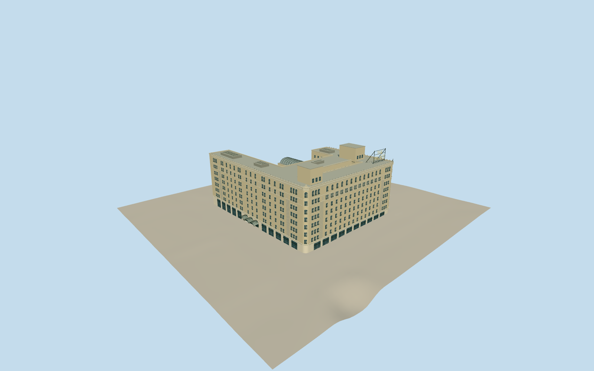

# Palace Hotel, San Francisco

Cream-brick 1909 Renaissance Revival hotel with eight storeys, rounded Market corners, terracotta cornices, triple curved entrance canopies, roof lightwell and open-frame THE PALACE sign.

Authoring state: **review-in-qa.json**. Current completion evidence is in [qa.json](qa.json) and the [local 100 ledger](../../../../qualla-structures/batches/PROGRESS.md).

- [Palace Hotel, San Francisco](https://qualla.com/palace-hotel-san-francisco/)

New actual entrance portals and physical curved double-door/transom framing use the exact native primary Highsmith entrance photograph under explicit photographer public-domain dedication, after a cleared Qualla imagery search. Earlier attribution/private report/satellite imagery is excluded as current construction control. Wider exterior review remains pending.

Three portals now cut into the actual close-level front wall, with stone jambs/arched soffits, recessed glazing and closed metal frames. Existing widths/heights/canopies retained; .72m recess, .14m frame depth and .65m transom spacing are medium-fi estimates. Exact gilded sculpture/face/monogram is not copied.

Existing city roof/parapet labels control principal heights; low-roof heights, floor spacing, hidden joins and fine terracotta ornament remain interpretations. Coarse map part heights conflict with the city elevations and are retained as evidence only.

Surviving 1909 exterior and attached lower pool/court roofs included. No 1875 reconstruction, interiors or proposed telecommunications equipment. Later rooftop changes are unverified.

Independent terrain remains unflattened; footprint suppression stays disabled. No photo pixels copied.

Build: `node packages/worldgen/scripts/generate-authored-places.mjs --ids=palace_hotel`. Add `--check` to verify exact regeneration. 59708 triangles; 5 materials; no embedded photographs.
