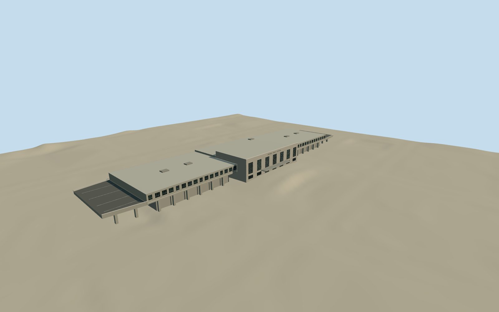

# San Francisco Transbay Terminal

The original Transbay Terminal in its 2008 bus-station era. A seven-bay granite pavilion faces Mission Street from the raised concrete transit deck.

Authoring state: **review-in-qa.json**. Current completion evidence is in [qa.json](qa.json) and the [completion ledger](../../../../qualla-structures/batches/qualla-003.PROGRESS.md).

- [San Francisco Transbay Terminal](https://qualla.com/san-francisco-transbay-terminal/)

Roof and the immediate elevated approaches are traced approximately from the June 2009 aerial. Protected street-level edges and rear details are estimates.

Most vertical dimensions, the street elevations and exact roof equipment lack a measured section.

The current unmodified ground samples provide an approximate grade datum for the historical building. Regional viaduct ramps and interiors are outside the modeled scope.

Build: `node content/worldgen/source/places/9q/9q8/san_francisco_transbay_terminal/models/generate-san-francisco-transbay-terminal.mjs`. Add `--check` to verify exact regeneration. 3126 triangles; 6 materials; no embedded photographs.
