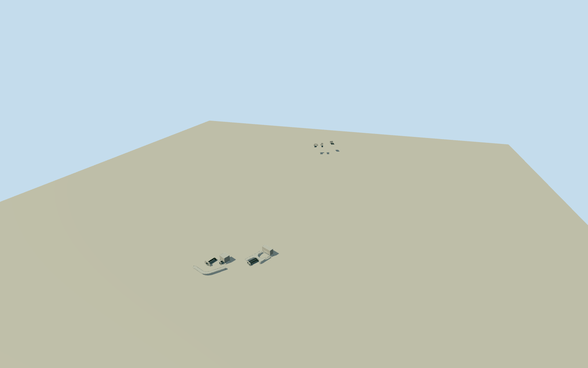

# Caldecott Tunnel

All four current Caldecott bores at both native endpoints: eight genuinely open short-lined mouths, older ArtDeco portal/vent architecture and plain third-bore west vent, restrained fourth-bore permanent concrete wings, whole native west vent footprints and two intrinsic curved service access bridges. Complete native1kmseparation/east-west rise retained, no mountain/site mesh/deep interior.

Authoring state: **review-in-qa.json**. Current completion evidence is in [qa.json](qa.json) and the [completion ledger](../../../../qualla-structures/batches/qualla-002.PROGRESS.md).

- [Caldecott Tunnel](https://qualla.com/caldecott-tunnel/)

AllfouroriginalnamedCaldecottTunnelmotorwayways9898614/782783447/782802221/782809091retainedwith22/21/14/14originalcenterlinevertices; eightactualendpointmouths retained, no singlegenericportal substitute. Original bores3/4 fullundergroundenvelopes1011848635/1011848634 establish separate physical widths/alignments. Whole west intrinsic ventilation houses way471964237(originaltwins)/105058294(third) retain5/4nonduplicatefootprintvertices; native serviceaccess bridgeouterways1094966707/1094966708andcenterlineways9899497/692903204 retained. Nearby four-bore tinybuildingtags without establishedidentity excluded. Anchor is meanofeightoriginalendpoints[-122.2138829125,37.85822675]; heading-0.7368148829613466from whole originalbore2axis, +Zwestapproach/-Zeast. Endfacade bearings follow actualendpoint/nearinside nativepath. Native west/East entrances and vent positions govern sizes; allnoheighttags. Fixed westbore2frontapproach[20.27675980814147,528.1275532763736]andindependent eastfrontprobe[20.668721162807902,-578.6442379455807]beforeterrain/geometry. East vent footprintnotmappedinretrievedwindow; photographicbounded estimates rather than claimed survey. Terrain provider values not floor survey; exactthreshold/grade/hostcarvingunverified.

Complete current four-bore exterior and eight original native endpoints, two whole western vent footprints and both native access bridges. Original four complete subterranean alignments/bores3and4envelopes are plan controls; only28mvisible mouth recesses are built, not deep hidden interior or1kmburiedlining. No genericoneportal substitute or invented mountain/sitefloor.

Four exact already-published local Qualla originals only: Pegship2007PD-selfwestern three-bore architecture and PedroXing2012CC0fourth permanent sideform/thirdplainvent,eastdecoratedportal,bore1lining. NativeSHA1/owncreatorgrants bound. Fourth completedface/unseen ornament and unphotographed east subsidiary faces remain restrained bounded estimates; no claim of exact current cosmetic finish. Caption2685bore3 retained without blindly assigning all east portal identities. CC-BYceremony/uncertainJPEGhero/other unrelated media unused; no copiedpixels/generatedbitmap.

Actual native plan widths/positions/onekmendpointseparation retained. All heights/clear sections/facade ornaments/pier depths/bridge support census/rail/stair spacing/hidden roofs remain photographic medium-fi estimates; source primarytext confirms4bores/2laneseach and1937/1964/2013eras. Original representative chevronfanrelief/pilasters/medallions, not exact sculptural reproductions. Skylinecoarsens arches to rectangles/relief/rails/buriedstair details within2.2merror; districtcoarsens ribs/medallions/railspacing within0.9merror.

Independent1400m141x141at10mTerrariumfield/rawtiles/grid/PNG frozen before geometry without flattening/fitting. Fixed west/east originalbore2frontapproaches give westdatum228.4939m/eastrelative46.4725m; commonfloorat eachend is provider-relative approximation, not surveyed roadway/tunnelgrade. Exact thresholds/cuttings/underbridge supports and host tunnelterraincarving/contact unverified; geographicpreview/replaceFootprintfalse. Flat review ground cannot certify east contact. No hillside mesh/trees/ordinaryroads/neighborhoodbuildings/vehicles/people/temporaryconstruction/lettering.

Build: `node packages/worldgen/scripts/generate-authored-places.mjs --ids=caldecott_tunnel`. Add `--check` to verify exact regeneration. 13486 triangles; 5 materials; no embedded photographs.
