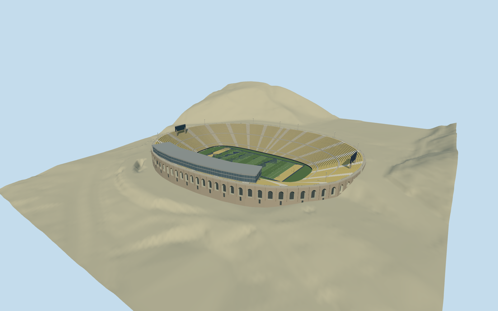

# California Memorial Stadium

The current California Memorial Stadium bowl with Berkeley’s historic west arches, gold bleachers, west press box and the hillside east terraces.

Authoring state: **review-in-qa.json**. Current completion evidence is in [qa.json](qa.json) and the [completion ledger](../../../../qualla-structures/batches/qualla-004.PROGRESS.md).

- [California Memorial Stadium](https://qualla.com/california-memorial-stadium/)

Stadium, field and press box use the measured map and LiDAR. Row exactness, small concessions and rail profiles are representative.

Team logos, temporary event signage and adjacent athletic-center interiors are outside the model.

Build: `node content/worldgen/source/places/9q/9q9/california_memorial_stadium/models/generate-california-memorial-stadium.mjs`. Add `--check` to verify exact regeneration. 21030 triangles; 6 materials; no embedded photographs.
