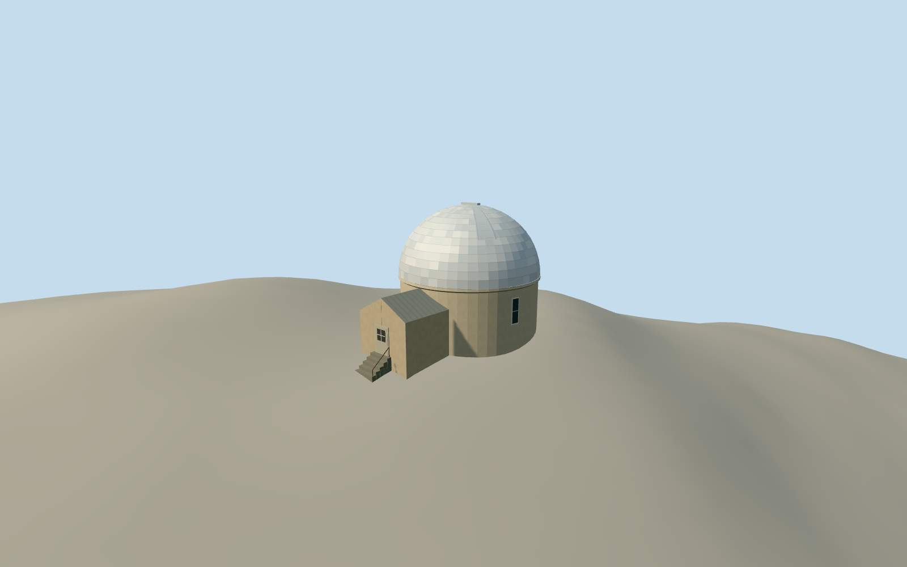

# Crossley Telescope Dome

The Crossley Telescope Dome at Lick Observatory, with its segmented metal hemisphere, round stucco drum and two projecting volumes on the original Mount Hamilton slope.

Authoring state: **review-in-qa.json**. Current completion evidence is in [qa.json](qa.json) and the [completion ledger](../../../../qualla-structures/batches/qualla-003.PROGRESS.md).

- [Crossley telescope](https://qualla.com/crossley-telescope/)

The August 2019 original controls the dome silhouette, pale segmented metal, drum and visible side sash. The telescope instrument and interior are outside the exterior scope.

Annex details, the northwest door, approach steps, trim and roof-shutter dimensions are approximate. The mapped ring controls the annex locations.

Original Mount Hamilton elevations are preserved. The thresholds and rock contact are estimated from the source heightfield.

Build: `node content/worldgen/source/places/9q/9q9/crossley_telescope/models/generate-crossley-telescope.mjs`. Add `--check` to verify exact regeneration. 3135 triangles; 5 materials; no embedded photographs.
