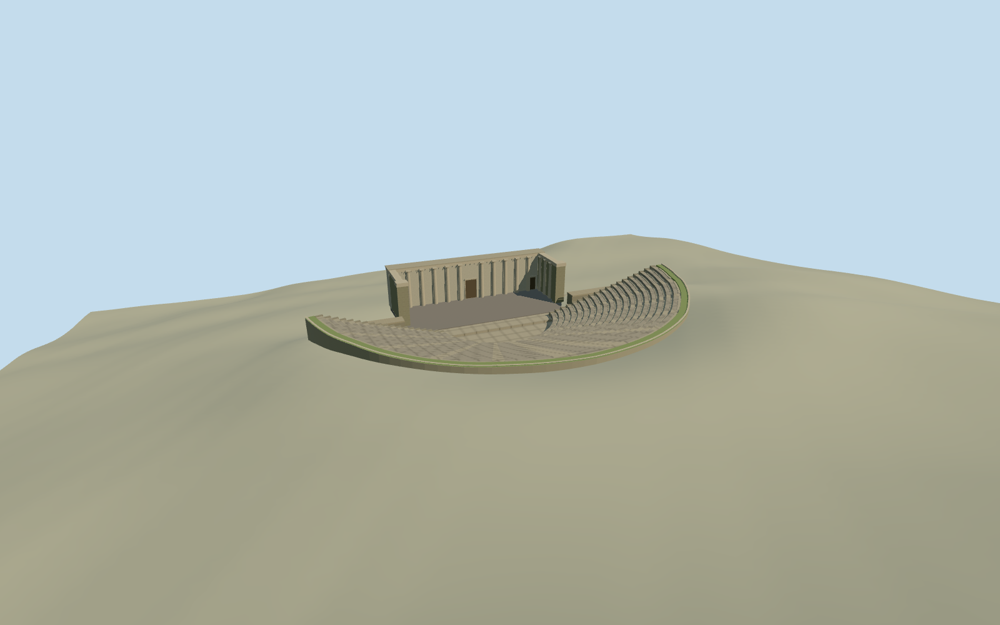

# Hearst Greek Theatre

The open-air Hearst Greek Theatre, with the natural hillside bowl, concrete bench tiers and three-sided Doric stage.

Authoring state: **review-in-qa.json**. Current completion evidence is in [qa.json](qa.json) and the [completion ledger](../../../../qualla-structures/batches/qualla-004.PROGRESS.md).

- [Hearst Greek Theatre](https://qualla.com/hearst-greek-theatre/)

The permanent theatre bowl, stage enclosure and immediate theatre retaining architecture. Later detached service areas and temporary concert installations are outside scope.

Surveyed tier count is retained. Minor decorative elements, individual step sizes and upper landscaping details are estimated.

Build: `node content/worldgen/source/places/9q/9q9/hearst_greek_theatre/models/generate-hearst-greek-theatre.mjs`. Add `--check` to verify exact regeneration. 10628 triangles; 8 materials; no embedded photographs.
