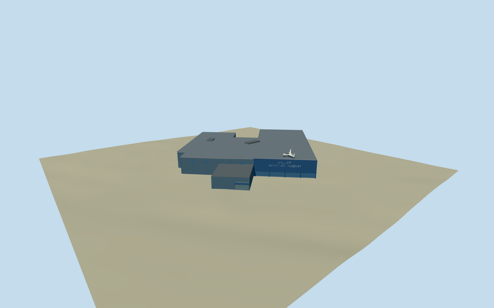

# Hiller Aviation Museum

The San Carlos airport museum with a stepped exhibition hall, blue panel frontage and a white Long-EZ display above its roofline.

Authoring state: **review-in-qa.json**. Current completion evidence is in [qa.json](qa.json) and the [completion ledger](../../../../qualla-structures/batches/qualla-004.PROGRESS.md).

- [Hiller Aviation Museum](https://qualla.com/hiller-aviation-museum/)

Height, roof drains and window positions on the less photographed elevations are estimated. The painted façade artwork is represented by its broad cladding colors. The model scope is the museum building and static rooftop display.

Build: `node content/worldgen/source/places/9q/9q9/hiller_aviation_museum/models/generate-hiller-aviation-museum.mjs`. Add `--check` to verify exact regeneration. 3132 triangles; 5 materials; no embedded photographs.
