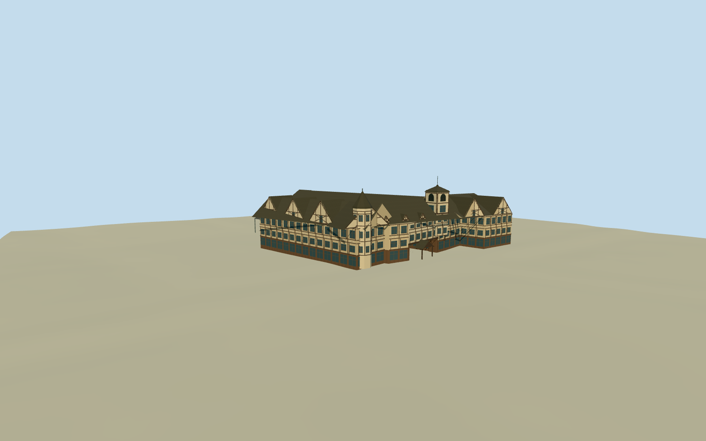

# Key Route Inn

The 1912 Key Route Inn in Oakland, a half-timbered hotel with a gabled Broadway frontage, mismatched towers and the open rail shed of the Key System terminus.

Authoring state: **review-in-qa.json**. Current completion evidence is in [qa.json](qa.json) and the [completion ledger](../../../../qualla-structures/batches/qualla-004.PROGRESS.md).

- [Key Route Inn](https://qualla.com/key-route-inn/)

The present city grade and historic street registration establish the exterior site. Exact elevations, roof ornament, upper rooms and structural detail of the train shed are approximate. The standalone garages, gardens and rolling stock are outside the modelled complex.

Build: `node content/worldgen/source/places/9q/9q9/key_route_inn/models/generate-key-route-inn.mjs`. Add `--check` to verify exact regeneration. 16409 triangles; 7 materials; no embedded photographs.
