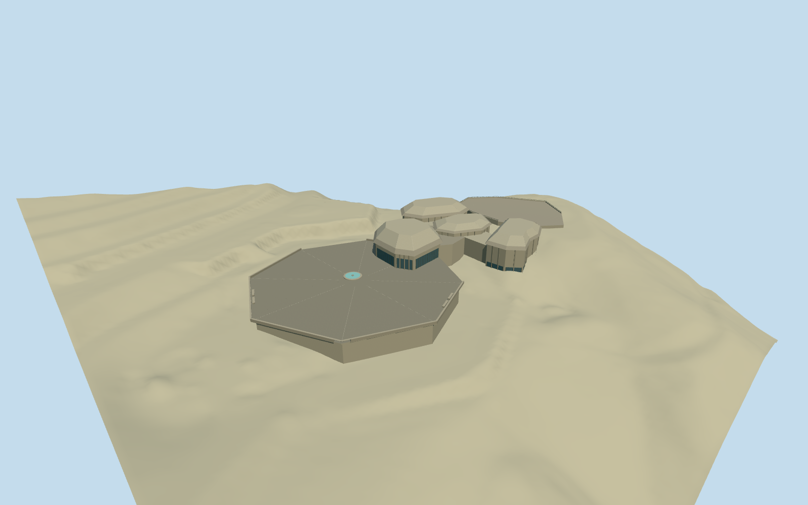

# Lawrence Hall of Science

The faceted concrete science hall and polygonal fountain plaza on the hillside above Berkeley.

Authoring state: **review-in-qa.json**. Current completion evidence is in [qa.json](qa.json) and the [completion ledger](../../../../qualla-structures/batches/qualla-004.PROGRESS.md).

- [Lawrence Hall of Science](https://qualla.com/lawrence-hall-of-science/)

The geographic outline and plaza features are mapped. Roof ridge elevations and portions of the concrete elevations use aerial and photographic scale estimates.

The model covers the current building and immediately connected public plaza and terraces. Exhibition interiors, moving installations and sculpture are outside scope.

Build: `node content/worldgen/source/places/9q/9q9/lawrence_hall_of_science/models/generate-lawrence-hall-of-science.mjs`. Add `--check` to verify exact regeneration. 4061 triangles; 6 materials; no embedded photographs.
