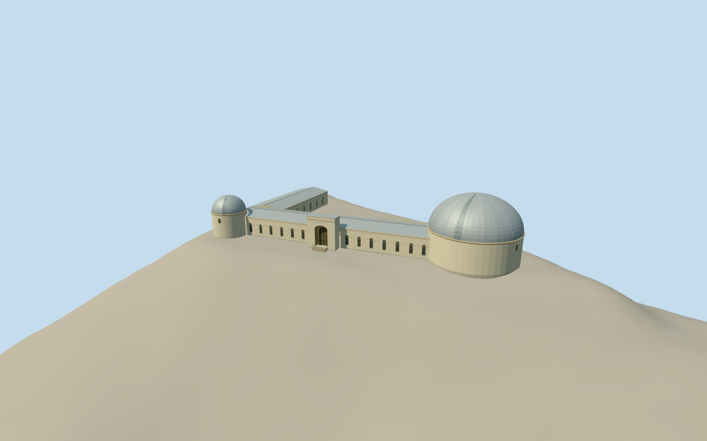

# Lick Observatory Main Building, Mount Hamilton

Lick Observatory’s main building with the large silver southern dome, smaller northern dome, connecting hall and west visitor entrance.

Authoring state: **review-in-qa.json**. Current completion evidence is in [qa.json](qa.json) and the [completion ledger](../../../../qualla-structures/batches/qualla-003.PROGRESS.md).

- [James Lick Telescope](https://qualla.com/james-lick-telescope/)

The 2019 exterior interpretation covers the Main Building, both attached domes and the east range. It depicts the south observing shutter closed.

The historic handbook and mapped footprint constrain the main dimensions. East-range fenestration, elevations, roof profiles and material wear are estimated.

The original summit terrain remains unchanged. The exposed foundation follows an approximate local grade.

Build: `node content/worldgen/source/places/9q/9q9/lick_observatory_main_building/models/generate-lick-observatory.mjs`. Add `--check` to verify exact regeneration. 10350 triangles; 6 materials; no embedded photographs.
