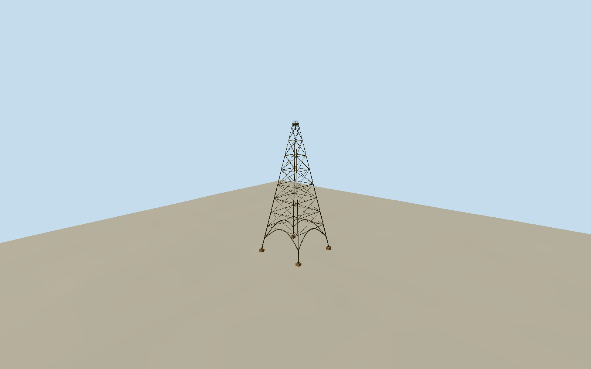

# San Jose Electric Light Tower

Original1881 downtown SanJoseElectricLightTower: whole four splayed tubular ironlegs on independentbrickcornerpiers, openstreetarches, tapering square horizontalgirters/Xdiagonalbracing, slimmaintenanceaccessladder, compacttopserviceplatform/6carbonarclamps/diffusingshield/30ftflagpole. Historical dated reconstruction at actual Market/SantaClara intersection; not1977halfsizeHistoryParkreplica, no surroundingstreets/buildings/trams/people.

Authoring state: **review-in-qa.json**. Current completion evidence is in [qa.json](qa.json) and the [completion ledger](../../../../qualla-structures/batches/qualla-002.PROGRESS.md).

- [San Jose Electric Light Tower](https://qualla.com/san-jose-electric-light-tower/)

PrimaryHistorySanJose states original237fttotal atMarket/SantaClara intersection, fourcornerfeet and6carbonarclights, versus1977HistoryParkreplica115ft. Historical207ftironframe63.0936m plus30ftpole9.144m total72.2376m. Exact native current roadjunctionnode1984576776 anchors original intersection[-121.8920664,37.3354708]; heading0.5358846203930857 alongSouthMarketway417034082, +Zsoutheast/+Xnortheast. Approximate24mx24mfourfootspan/12mlowerarch and8trussbays proportioned from exact1881publishedprint and cornerstreetspan, not a mapped surviving footprint or surveyed frame. Current roadlines/grade do not certify1881 streetalignment/footlocations.

Four independent brick pier tops fixed at1.2m above original intersection provider datum27.1207m, selected before geometry. Each isolated foundation toe samples original independent modern field. Original1881 pavement/footing elevations unverified; no whole-intersection slab or field flattening/fitting/reacquisition.

Dated original1881 reconstruction, current-world excluded;1977HistoryPark115ftreplica notmodeled. Fourfoot24msquare span, lowerarchcurve/bracebaycensus, pipegauges, brickpiersections, accessladder routing, colors, lamp/reflector/serviceplatformhardware approximate from one contemporaneous print. Sixarclamps/207ftframe/30ftpole from primarytext; later incandescentstrings/repairs/collapse notrepresented.

One individually inspected exact published H.G.Peelor10Dec1881 HarperWeeklyp821 public-domain illustration with original bytes/native revision and dated citation. Qualla heroCCreplicaphoto and othercity/CCmediaunused. No supplementalimages/photographictextures/generatedbitmaps/borrowedmesh.

Independent256m129square16641-sample modernsourcefield/four originalTerrariumtiles frozenbeforegeometry. Provider27.1207mintersectiondatum and fourpier tops1.2m fixed, foundationtoes sample unchangedmodernfield; original1881pavement elevations/hostcontactunverified. No groundflattening/fitting/reacquisition or whole-intersectionplatform; dated geographicpreview only.

Four LODs retain four splayed legs, openarchedstreetspan, tapering lattice and lamptop/shield/flagpole. Skyline alternates single diagonals/reducedbaycount; district restoresXbraces; nearpipeflanges/crossbolts/ladderrungs/crown hardware added.

Build: `node packages/worldgen/scripts/generate-authored-places.mjs --ids=san_jose_electric_light_tower`. Add `--check` to verify exact regeneration. 17212 triangles; 3 materials; no embedded photographs.
