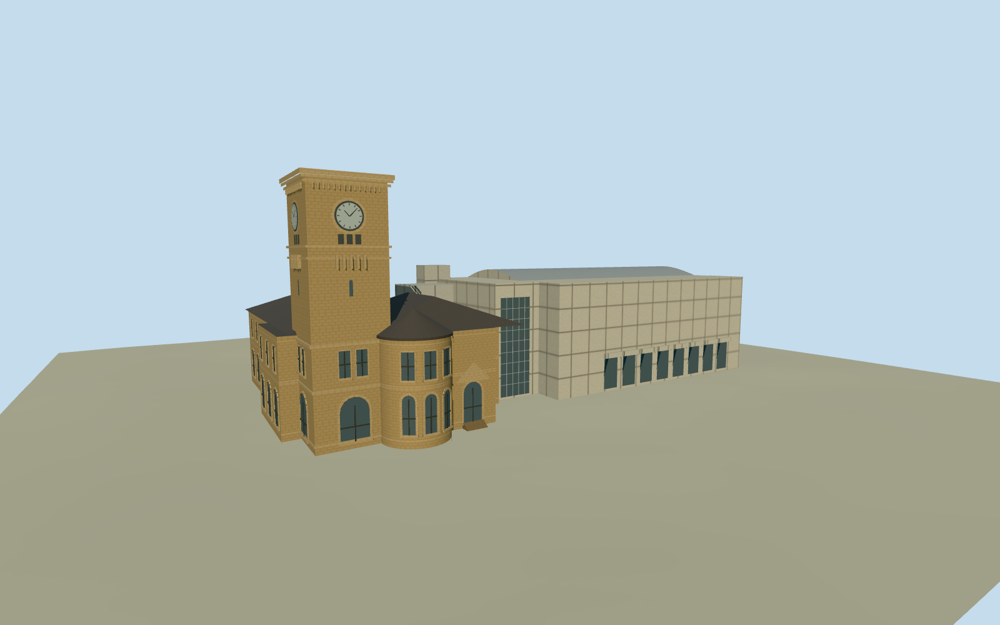

# San José Museum of Art

The sandstone Old Post Office and its corner clock tower beside the modern gallery wing.

Authoring state: **review-in-qa.json**. Current completion evidence is in [qa.json](qa.json) and the [completion ledger](../../../../qualla-structures/batches/qualla-004.PROGRESS.md).

- [San Jose Museum of Art](https://qualla.com/san-jose-museum-of-art/)

Rear ornament and historic roof divisions use the native footprint and architectural estimates.

Modern gallery roof follows the mapped sections. Temporary signage, exhibitions and freestanding plaza artwork are omitted.

Build: `node content/worldgen/source/places/9q/9q9/san_jose_museum_of_art/models/generate-san-jose-museum-of-art.mjs`. Add `--check` to verify exact regeneration. 4829 triangles; 7 materials; no embedded photographs.
