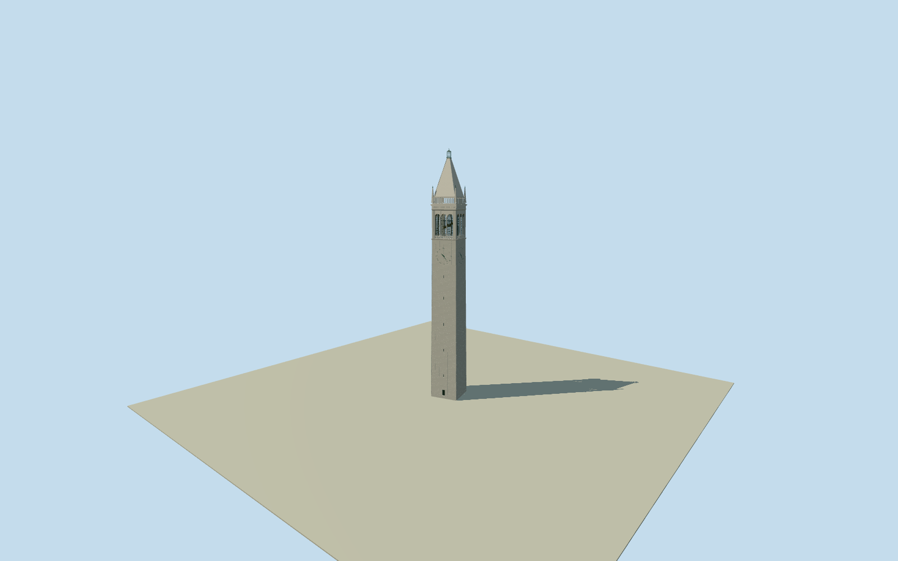

# Sather Tower

Whole Berkeley Campanile: native seven-control pale tapering stone tower, physical recessed shaft slits/closed doorway, four original Roman numeral clocks/hands, twelve genuine round-arched belfry openings/paired slender columns/physical iron grilles and low balustrades, bounded visible hanging bells, major cornices/upper parapet/four corner pinnacles/steep stone pyramid/open green metal lantern and finial. Published Qualla2025creatorCC0 upper original first, distinct2013creatorCC0 full-height view; original geometry only, no copied pixels. Native10.55x10.28m extent; official307ft overallheight/200ft observationfloor. Exact hidden sections/census/door/fine carving/finish/groundcontact remain original estimates.

Authoring state: **review-in-qa.json**. Current completion evidence is in [qa.json](qa.json) and the [completion ledger](../../../../qualla-structures/batches/qualla-002.PROGRESS.md).

- [Sather Tower](https://qualla.com/sather-tower/)

Whole actual named native way24024507/Q357019, closed8point ring/seven unique controls. Exact fixed native bboxanchor/heading0/+Xeast/+Zsouth before independentground acquisition; original slightly rotated native outline retained, not a generic invented square. Main shaft/belfry/pyramid and finial sections/slit census/clock layout/hiddenbase are original photographic estimates after frozen ground. OfficialUC307ft overallheight (93.5736m), native93.6 tag agrees; precise survey/tower-axis location not asserted.

Independent256m129x12916641sample/one rawtile/fixedSW96.7538m provider-relative field frozen before every floor/section/taper/geometry choice. Main tower-centre floor1.7039m fixed once from original grid BEFORE geometry; no late modelraising/field fitting. Native7controls are four corners/three intermediate points on nearly straight edge, not an entrance projection. Whole lower tower walls actually use all seven; upper shaft/clockzone/belfry/pyramid follow original photographic proportions and the native rotated axes, no invented mapped polygon. Native10.55x10.28m extent retained, original upper taper .9. UC overall307ft=93.5736m and observationfloor200ft=60.96m; original clockcenter54.7m, triple-arch floor62.05/spring68.85/cornice73.45, parapet76.05, pyramid76.2-89.7, green lantern90-92.66/finial93.5736, corner pinnacles74-80.15. Slit and bell census/hiddenback/door/roofprofiles/clock-face proportions/fine carved details/currentfinish are original estimates. Native nodes contain no entrance tag; closed base doorway is photo-bounded original estimate, not mapped. Whole structure retained; no SatherGate/esplanade/trees/sculpture/campusinteriors/copiedpixels. No terrainfit/flatten/reacquire/late modelraising; preview/replacementfalse/precisecontactunresolved.

Exact cleared published2025RyanSchwark selfCC0 upper original first and distinct2013Daderot selfCC0 whole-height original individually inspected/nativeSHA1matched; rejected published and conflictedhero imagery excluded without repair or same-photo bypass. Clock numerals/hands original geometry with static10:24; all four faces original estimated repetition. Carillon shapes are six approximate visible bells, not a61bell interior reconstruction. Fine sculptural friezes reduced to original geometric articulation; no copiedart/inscriptions/photos/interiorrooms/fossils/adjacentgrounds/trees.

Original independent256m129x12916641sample/one rawtile/fixedSW96.7538m provider-relative field frozen before floor/section/taper/geometry. Floor1.7039m fixed once from original centre sample before geometry; no refit/flatten/reacquisition/late modelraising. Exact base/threshold/source-grade contact unresolved; geographic preview/replaceFootprint=false. Flatground/syntheticneighbors are review fixtures.

Build: `node content/worldgen/source/places/9q/9q9/sather_tower/models/generate-sather-tower.mjs`. Add `--check` to verify exact regeneration. 43076 triangles; 3 materials; no embedded photographs.
