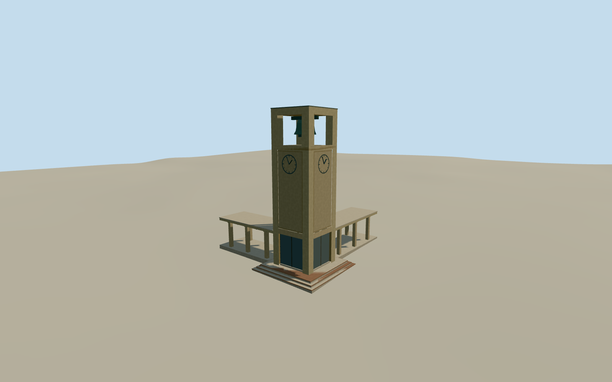

# Stanford Clock Tower

Stanford Clock Tower in February 2009, with tan inset panels, four open belfry faces, bronze dials, glazed base and adjoining colonnades.

Authoring state: **review-in-qa.json**. Current completion evidence is in [qa.json](qa.json) and the [completion ledger](../../../../qualla-structures/batches/qualla-003.PROGRESS.md).

- [Stanford Clock Tower](https://qualla.com/stanford-clock-tower/)

The 2009 tower exterior is reconstructed from one exact photograph and georeferenced campus controls. Two off-camera faces use symmetry. Belfry hardware, rail features, pergola arm extents and hand angles are approximate.

The original terrain is unchanged and the terrace stair fit is approximate. Separate campus structures and the clockwork mechanism are outside the model scope.

Build: `node content/worldgen/source/places/9q/9q9/stanford_clock_tower/models/generate-stanford-clock-tower.mjs`. Add `--check` to verify exact regeneration. 1792 triangles; 3 materials; no embedded photographs.
