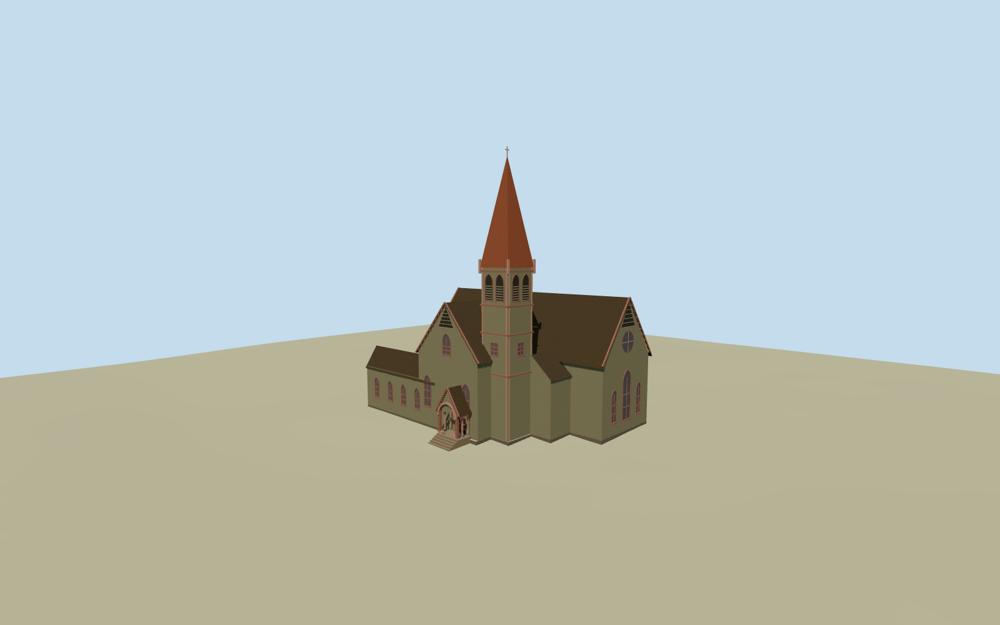

# Trinity Episcopal Cathedral (San Jose, California)

The 1863 Carpenter Gothic cathedral on St. James Square in San Jose, with steep redwood gables, stained glass, and the corner spire.

Authoring state: **review-in-qa.json**. Current completion evidence is in [qa.json](qa.json) and the [completion ledger](../../../../qualla-structures/batches/qualla-004.PROGRESS.md).

- [Trinity Episcopal Cathedral (San Jose, California)](https://qualla.com/trinity-episcopal-cathedral-san-jose-california/)

Exterior of the identified historic church, excluding separate parish and office buildings.

Unpublished stack and roof heights are estimated from the mapped plan and verified photographs.

Build: `node content/worldgen/source/places/9q/9q9/trinity_episcopal_cathedral_san_jose_california/models/generate-trinity-episcopal-cathedral-san-jose-california.mjs`. Add `--check` to verify exact regeneration. 6538 triangles; 6 materials; no embedded photographs.
