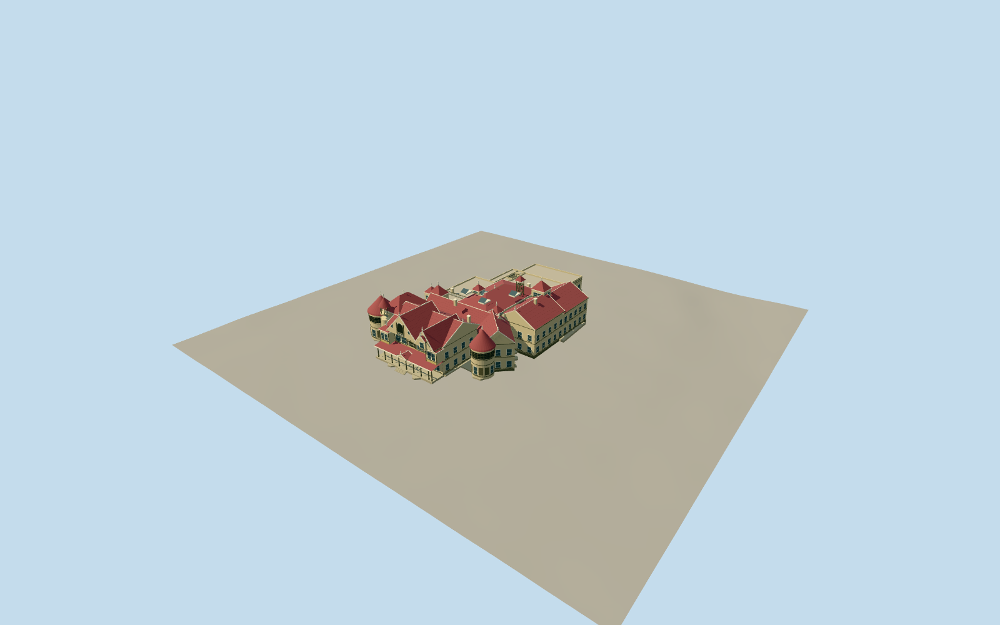

# Winchester Mystery House

Surviving mansion core with irregular red roofs, east cross-gables, open veranda, two round turrets, suspended door, roof towers, skylights and braced bell frame.

Authoring state: **review-in-qa.json**. Current completion evidence is in [qa.json](qa.json) and the [local 100 ledger](../../../../qualla-structures/batches/PROGRESS.md).

- [Winchester Mystery House](https://qualla.com/winchester-mystery-house/)
- [Winchester Mystery House](https://qualla.com/#list/9q9k/winchester-mystery-house-wp)

Original medium-fi mansion-core exterior based on individually inspected Qualla 2002–2019 images, museum 2018 aerial, rear view and 2023 estate map. It is not a measured survey.

Map data combines the mansion with connected estate buildings. Recorded editorial north/south cuts exclude stables, greenhouses, visitor buildings and their connecting wings; the full original footprint is preserved as evidence.

Main gables, turrets, veranda, suspended door and roof features follow inspected references. Individual hidden roof intersections, upper-floor positions, window spacing and ornament are approximate; no interior layout is reconstructed.

Scalloped shingles, stained glass and turned woodwork are original simplified cues. No reference-image pixels are embedded. Demolished seven-story tower, furnishings, gardens and vegetation are excluded.

Independent coarse terrain is preserved, with foundation extending below the reviewed contact datum. Another host DEM may produce different exact ground contact.

Build: `node packages/worldgen/scripts/generate-authored-places.mjs --ids=winchester_mystery_house`. Add `--check` to verify exact regeneration. 23918 triangles; 6 materials; no embedded photographs.
