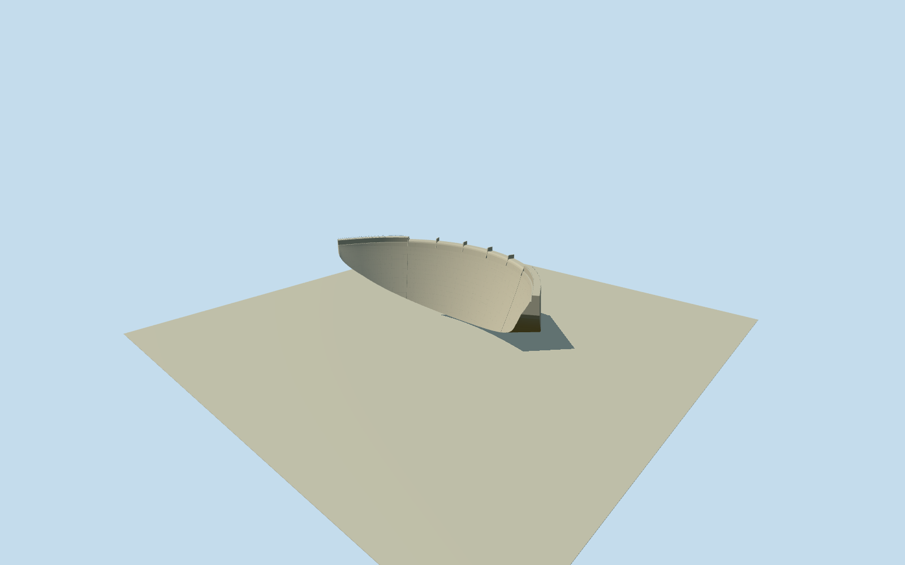

# Englebright Dam

Dry concrete arch dam with rounded ungated five-bay overflow crest, four tall intermediate concrete piers, two low end transitions, raised nonoverflow abutment wings, tapered upstream/downstream walls and own end maintenance rails. Original NHD dam envelope controls location/chord/curvature; official348.08mcrest/79.248mheight/6.4008mwidth control bounded section estimates. No river/gorge/water or separate powerhouses/intakes.

Authoring state: **review-in-qa.json**. Current completion evidence is in [qa.json](qa.json) and the [completion ledger](../../../../qualla-structures/batches/qualla-002.PROGRESS.md).

- [A Dam Built for Ghosts](https://qualla.com/englebright-dam/)

Exact named Englebright damway92797656/Q5378079/USNIDCA10105and full original32vertexNHDpolygon establish geographic identity and approximate curved envelope. This old NHD area is coarse, not a surveyed crest/top/base: upstream arc measures about302mwhere owner states348.0816mcrest, and nativeheight85mdiffers from official79.248m. Preserve original geometry/evidence but do not claim or rescale a surveyed full dam from it. Original endpoint chord establishes heading/anchor; follow original approximate upstream curve for visible arch with explicit estimated end-wing extension/sections as needed to include full official crest length. Photographs and official dimensions govern shape; no fit to storypoint or terrain. Neighboring powerhouses/intakes and gorge are separate.

Original coarse NHDupstream edge302.13m/chord249.90m/sag71.99m is preserved as evidence. A circular arc from original chord/sag interprets the owner-described constant-angle arch; short tangent end-wing extensions supply the remaining nominal348.0816moverall crest. This is an explicit section/wing interpretation, not a claim of exact native crest boundaries or a surveyed length match.

Owner260ft/79.248mcentral structural height and21ft/6.4008mcrest width bound the dry structure. Lower wall thickening/ogee curvature, rising bank foundations, wing/pier height, rail/joint sections and concealed bedrock contact are estimates; native85mheight is not substituted for owner facts. Spillway crest527ftMSL is separate from frozen provider-relative western-bank reference.

Two exact published Qualla originals, USACE MichaelNevins aerial and MichaelJ.NevinsJune2010spillway photograph, were inspected at native detail and bound to explicit government-work primary records/nativeSHA1. An omitted generated Qualla category for the latter is resolved with a hash-bound exact primary USACE release/agency/named Army photo credit; Qualla media metadata is untouched. No questionable/attribution image, generated bitmap or copied pixels.

Four tall intermediate piers divide five ungated central overflow bays, with low end transitions and raised nonoverflow wings/own rails. Flowing water conceals the lower center in the close photo; no guessed outlet, gate, roadway bridge or covered spillway is added. Lower body is a bounded tapered arch estimate; no engineering/hydraulic/interior replica claim.

Static dry dam only. Narrows I/IIpowerhouses/intakes/operation buildings, canyon/river/lake/rock/forest, access roads, boats/people/water/spray/rainbow and signs are separate and excluded. Raw500mTerrariumfield remains unchanged with fixed dry bank reference; illustrative stage below foundation is not surveyed terrain or certified gorge/abutment contact.

Build: `node packages/worldgen/scripts/generate-authored-places.mjs --ids=englebright_dam`. Add `--check` to verify exact regeneration. 11906 triangles; 2 materials; no embedded photographs.
