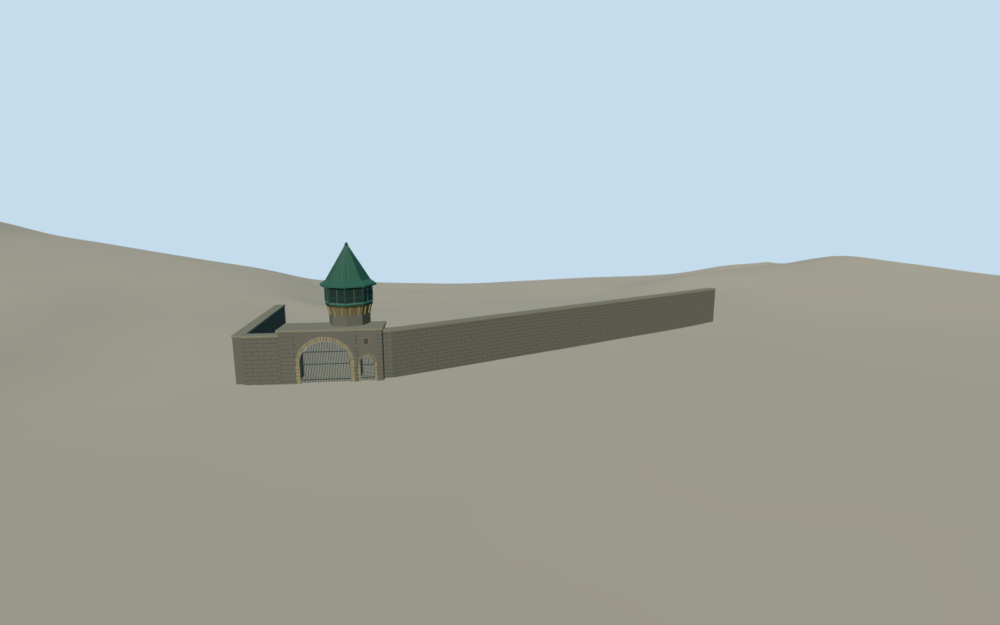

# Folsom State Prison Entrance

The early-2000s exterior of Folsom State Prison’s granite entrance, with twin barred arches, a corbelled tower and a steep green roof.

Authoring state: **review-in-qa.json**. Current completion evidence is in [qa.json](qa.json) and the [completion ledger](../../../../qualla-structures/batches/qualla-003.PROGRESS.md).

- [Folsom State Prison](https://qualla.com/folsom-state-prison/)

The model covers the photographed entrance, green-roof tower and visible stretches of granite wall. The larger prison grounds, interior structures and other eras fall outside this scope.

Arch sizes, tower height and the far wall return have been estimated from the photographs and mapped approach. Plaques, signs and fixtures are simplified.

The original public terrain supplies context and approximate elevations.

Build: `node content/worldgen/source/places/9q/9qc/folsom_state_prison/models/generate-folsom-state-prison.mjs`. Add `--check` to verify exact regeneration. 5100 triangles; 5 materials; no embedded photographs.
