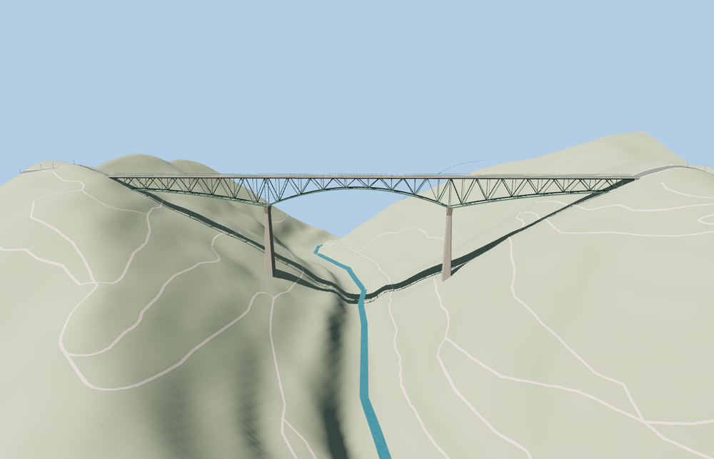

# Foresthill Bridge

Full Foresthill Road canyon crossing with a green variable-depth cantilever deck truss, two tapered concrete piers, separated carriageways, sidewalk ledges, rail screens and canyon abutments.

The source master has 36,892 triangles. The skyline, district, street, and close-up tiers have 884, 3,628, 11,260, 26,668 triangles. The first two tiers total 361,184 bytes. The close-up tier is 2,080,044 bytes. Six GLBs passed validation and 34 current views were inspected.

All four tiers pass 12 carriageway joins within 0.15 m and 16 approach checks within 0.30 m. Both piers meet the canyon slopes. Six trail probes and three river centerline probes show zero obstructions at their test heights. The viewer retains 12 mapped lower route parts. Model unload and failed-load fallback both passed.

The retained 747.54 m bridge outline and the two Foresthill Road carriageways set the signed frame. Photos guide the pier and truss profiles. The 231.4 m source datum is the lower footing elevation. The original standard elevation field and mapped trails determine visual fit. The largest approach difference is 0.278 m at the west approach. The PMTiles input supplies a river line at this location and the viewer renders its native water strip. River clearance is a render measurement. Physical-device timings remain unmeasured.

Rebuild with `node packages/worldgen/scripts/generate-foresthill-bridge.mjs`. Append `--check` to compare exact output bytes. Use `--ids=foresthill_bridge` for targeted import, LOD, placement, and readiness. The generator is registered in asset-build.json.
