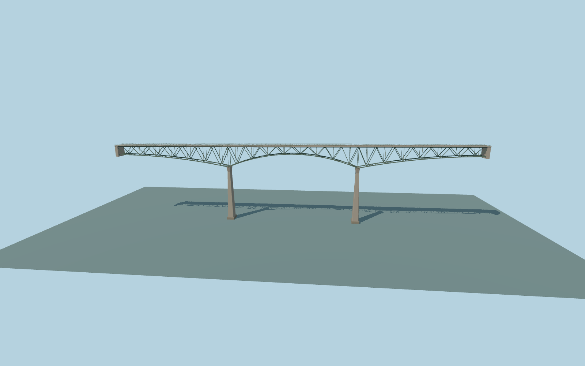

# Foresthill Bridge

Full Foresthill Road canyon crossing with a green variable-depth cantilever deck truss, two tapered concrete piers, separated carriageways, sidewalk ledges, rail screens and canyon abutments.

Run `node packages/worldgen/scripts/generate-foresthill-bridge.mjs` to rebuild the source master. Append `--check` to compare the exact bytes. Use `--ids=foresthill_bridge` for targeted import, LOD generation and placement.

The OSM outline and divided roadway establish the frame. Truss panel proportions, pier taper and cross-braces follow ordinary exterior photos.

The roadway and pier footing elevations fit the standard Terrarium grid. Visible pier stations and end structures are geometric approximations.

Original geometry:repository license. Map:© OpenStreetMap contributors,ODbL-1.0;Protomaps. Standard terrain:terrain-grid.json. Ordinary pictures stay local and are not redistributed or used as textures. Current acceptance:qa.json.
