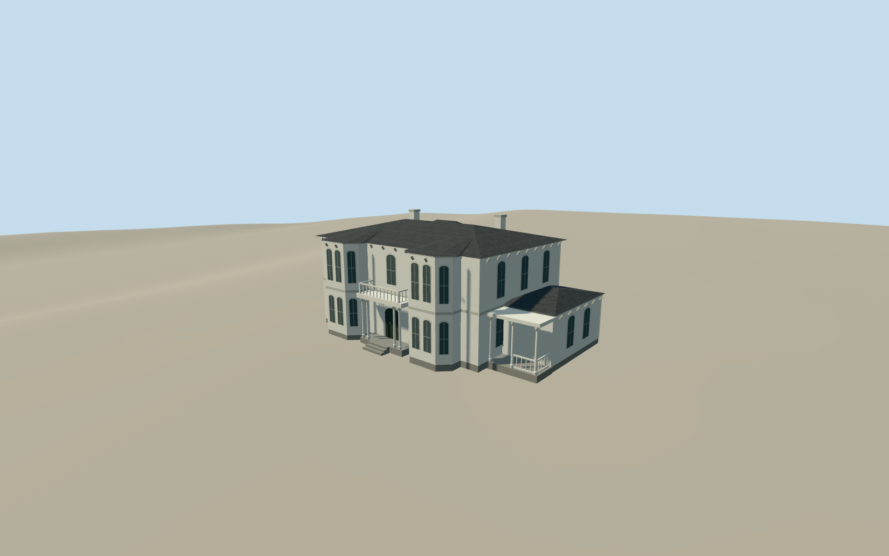

# Griffith Mansion

The June 2009 Griffith Mansion in Yolo, with twin polygonal bays, white Italianate siding, arched sash and a columned porch.

Authoring state: **review-in-qa.json**. Current completion evidence is in [qa.json](qa.json) and the [completion ledger](../../../../qualla-structures/batches/qualla-003.PROGRESS.md).

- [Griffith Mansion](https://qualla.com/griffith-mansion/)

The June 2009 exterior omits interiors, detached buildings and private landscape features. The extent of obscured wall lines, rear windows and roof folds is approximate. Columns, brackets and sash ornament are simplified.

Federal orthophotography controls scale and position. The original terrain remains unchanged. Step and threshold contact is approximate.

Build: `node content/worldgen/source/places/9q/9qc/griffith_mansion/models/generate-griffith-mansion.mjs`. Add `--check` to verify exact regeneration. 4126 triangles; 5 materials; no embedded photographs.
