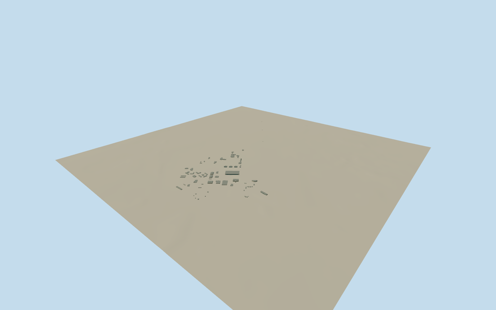

# Former Castle Air Force Base — surviving built campus

Whole current surviving former-base built campus:84 individually mapped building/tank footprints,10hangars, operations/training/support blocks and native aircraft-control tower. Open spatial gaps remain. Clear published Qualla USAF1982 parade-ground aerial guides older industrial character only; hidden/current roofs, sections/openings/colors/tower form original estimates. No site extrusion, runway, aircraft, detached housing, later prison or outside museum display.

Authoring state: **review-in-qa.json**. Current completion evidence is in [qa.json](qa.json) and the [completion ledger](../../../../qualla-structures/batches/qualla-002.PROGRESS.md).

- [Castle Air Force Base: Christmas Eve, and the Fifty Years After](https://qualla.com/castle-air-force-base/)

Every complete current native footprint of84 structures in the contiguous former-base airport/campus plus actual mapped control-tower point. No extrusion of the three membership parcels, no missing-building shortcut or arbitrary campus rotation. Source/closeup preserve all native controls and current spatial gaps. Skyline uses individually bounded complete-volume proxies; detailed wall/roof/current conservation and unobserved tower form are original estimates.

Original4096m129x129/16641-height field and25 raw tiles frozen before every floor/main section. Each floor is the independently sampled12m outward approach of its native longest edge; no later foundation/floor/roof/field fitting. Approximate13.2m large-hangar eaves/9.2m smaller hangars/4.5-6.5m one-level support buildings/4.8m tanks, low2.5m hangar gables/1.5m small gables. Tower24m stem/27.5m cab glass/28.4m roof/30.4m antenna are original unphotographed estimates. Coarse source field does not prove classification, exact contact or thresholds.

The accepted1982USAF aerial shows the parade-ground area and one major hangar only. Current84-building inventory is independently mapped; not every present roof, building, operator or tower appearance is photograph-observed. Hidden/current architectural sections, openings, materials and tower form are original bounded estimates.

Source/closeup retain every native whole perimeter and ground position. Skyline uses individual oriented rectangular full-volume proxies for support buildings and simplified tank/hangar/tower roofs. Some small wing recesses fill only at this distant level, within predeclared35m maximum plan envelope error. No source parcel extrusion or lost buildings.

Base-wide runway/taxiway/apron/landscaping, display aircraft, detached outdoor museum, later prison and detached historical housing annexes are outside this architectural model. No interior or historic1982 snapshot claim.

Current coarse unclassified DEM and per-building approach grades do not establish exact threshold/ground contact or precise floor levels. Original field, native frame, chosen floors and main sections remain unchanged after authoring.

The existing renderer supports64 physical terrain openings per placement. The64 largest actual footprints receive cutouts;20 small structures retain the original field. All84 whole buildings remain in every LOD with unchanged floors and sections. No bridging of open campus space or fabricated site cutout.

Build: `node content/worldgen/source/places/9q/9qd/castle_air_force_base/models/generate-castle.mjs`. Add `--check` to verify exact regeneration. 20410 triangles; 4 materials; no embedded photographs.
