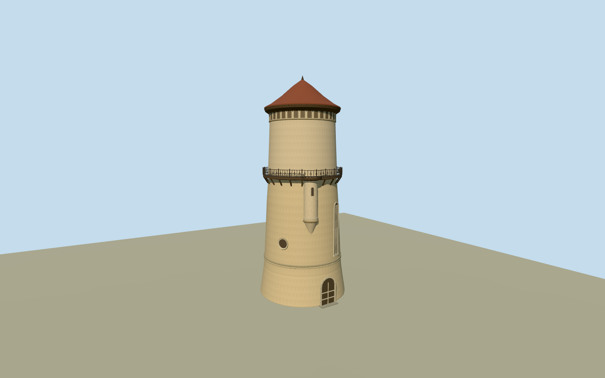

# Old Fresno Water Tower

Fresno’s cream-painted 1894 water tower with an ornate iron balcony, projecting stair turret and red tiled roof.

Authoring state: **review-in-qa.json**. Current completion evidence is in [qa.json](qa.json) and the [completion ledger](../../../../qualla-structures/batches/qualla-004.PROGRESS.md).

- [Old Fresno Water Tower](https://qualla.com/old-fresno-water-tower/)

The source does not provide measured sizes for openings, trim, the exact position of all small openings, or the balcony ironwork. Those dimensions are approximate.

The structure covers the tower exterior. The separate plaza facilities and interior tank mechanism are outside the model scope.

Build: `node content/worldgen/source/places/9q/9qd/old_fresno_water_tower/models/generate-old-fresno-water-tower.mjs`. Add `--check` to verify exact regeneration. 14531 triangles; 6 materials; no embedded photographs.
