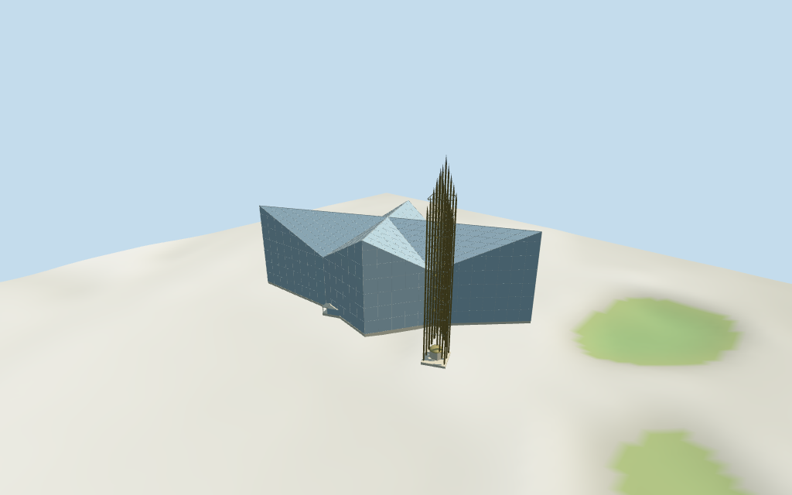

# crystal_cathedral — Crystal/Christ Cathedral review

Reviewed2026-10-15 against current source/runtime bytes.Accepted for medium-fi exterior and approximate horizontal placement. **Exact runtime ground contact remains unverified.**

## Built result

Inspected11 current portable/source-terrain frames. Individually authored Crystal/Christ Cathedral has a four-point folded glass shell,high sharp wing tips,large sloping roof planes and inward valleys. Blue-gray reflective opaque glazing has silver primary frame lines and low pale rectangular entry canopies with actual recessed glass doors. The small current-map notch is a connected low entry projection. Separate mapped73m steel spire has staggered pointed blade/prism elements,real gaps/open lower base,connectors,simplified inner bell rows and a small pale circular pavilion with shallow gold-toned cap. Refined the portable glass color and near blade density. Canonical grid pitch,roof valley interpretation,entrances and individual steel/bell/pavilion details remain approximate;no reflected sky/tree photographs baked into surfaces.

Medium-fi exterior from three actually inspected2007/2009 Commons photographs:two whole glass-shell/spire exteriors byArnold C (Buchanan-Hermit) andWattewyl,plus complete stitched spire detail byWattewyl,with standard viewer PMTiles/DEM.No bespoke plans/surveys researched or photographs/reflections redistributed. Four-point glass shell,folded high tips/inward valleys,detached tall pointed-steel spire and open base/small pavilion are individually authored. Raw heights/original identity retained with explicit estimated floor/profile interpretation. Opaque reflective glazing simplifies transmission/interiors;canonical pane pitch differs from exact facade grid.Hidden roof joints,exact entry arrangement,steel sections/blade offsets,bell count,small pavilion and current campus changes remain estimates.Fine signage,engineering detail and interiors excluded or simplified.Exact terrain joins and physical-device measurements pending.

## Shared materials and placement

Inspected11 current shared/geographic frames. Four existing cached256-square commercial window-grid,polished stainless steel,painted metal and plain concrete graphs serve five merged groups;skyline is one draw. Actual viewer window-slot material uses its existing untinted glass variant;skyline glazing uses the canonical graph mean and portable fallback uses blue-gray linear color. Metric UVs and flat architectural normals;gold-toned small accents use local geometric PBR. No embedded images,unique facade maps or baked reflections. Each graph reads once;unload disposes geometry and leaves zero live model geometries. Fixed capture-helper telemetry to recognize the existing :glass material-name variant under its canonical shared reference;current capture asserts the actual texture UUID is present. Details show shared pane grid,primary frame geometry,recessed doors,open blade structure and small pavilion. Signed top placement matches both separate controls. Flat geographic ground does not verify standard DEM/plaza thresholds;detail cameras intentionally crop other sections.

Retained exact-QID way/29280620,Q1051217,current Christ Cathedral name and legacy Crystal Cathedral candidate match current main35184401369452. Main11 vertices differs from earlier32 distinct vertices;separate73m spire35184492802876 adds4 vertices. All15 raw current vertices/tags and40m/73m heights reproduce rigidly without rescale;empty Wikidata dimension arrays and original multilingual identity remain intact. Anchor[-117.898898516,33.787396967],heading-0.442946546014rad. Native+X east-southeast along shell,+Z south-southwest across it;separate spire lies at[-44.91,-20.71],signing the frame. Spire association is positional/visual,not an independent exact-QID claim.40m wing/central roof highs,24m inward valleys,low entrances,steel blade/connector/bell profiles and pavilion are picture interpretations,with highest spire tip73m.42 current viewer footprint checks cover both controls while retaining four neighbors and the open plaza gap across six outputs. The initial coarse footprint incorrectly covered that gap;localized triangle subdivision corrected it. DEM datum39.853387m,estimated floor0.8m,raw main/spire perimeter-0.09..0.37m. Footings crossY=0 and extend below raw samples. Exact plaza/street/door contact,base clipping,absolute altitude and walking remain unverified;no preview flattening,host terrain change or road replacement.Other campus buildings/basins/gardens remain host content.

Inspected27 current Earth-lighting frames:Economy/High,noon/late,three distances,texture-free silhouette,six details,four matched whole LODs and four transitions. Skyline preserves folded shell/high tips,open steel spire/staggered crown and base pavilion at828 triangles. District adds shared pane grid,coarse geometric roof-frame lines,spire connectors and actual entry/pavilion recesses at1780 triangles. Street adds finer roof/wall frame lines,20 steel blades and simplified inner bell rows at5024 triangles. Closeup/master refine frame density,blade seams,connectors and bell profiles at7960 triangles. Every level retains genuine air gaps through the spire. Local triangle subdivision around the real component gap prevents conservative viewer footprint stamps from swallowing the plaza. Matched whole LODs include complete73.8m local tips above an estimated0.8m floor;generic street/detail fixtures intentionally crop other sections. Synthetic cottages/coarse terrain are fixtures. Physical phone/laptop timing remains pending.

## Browser budgets

| Level | Triangles | Bytes | Draws |
| --- | ---: | ---: | ---: |
| skyline | 828 | 72244 | 1 |
| district | 1780 | 152852 | 5 |
| street | 5024 | 421956 | 5 |
| closeup | 7960 | 702128 | 5 |

Initial skyline plus district: **225096 bytes** of geometry.Master: **958508 bytes / 7960 triangles**.Four existing shared256-square graphs,zero embedded images.Bytes exclude graph definitions/texture generation.Split POSITION/NORMAL streams have equal CPU/GPU totals.Physical-device timing pending.

## Verification

- Targeted byte reproduction and current source/import/LOD/input/report bindings;source/recipe inventory/schema match.
- Six Khronos validations:zero errors/warnings/images.Four browser budgets pass.
-15 current vertices/tags,main exact identity/prior32-distinct-vertex control,40/73m raw heights and standard DEM match.
- **156 imported geometry probes** and **42 current viewer footprint checks** pass.
- Actual shared glazing/steel/painted-metal/concrete texture reads,read-once/unload and hash-bound geographic/medium-fi reviews pass.
- Scene validation and30-tick simulation:sha256:8accabc9a1dc340403abfa70ed2ce720cb49564781b6149f4c9f0f85e0961407.
- Actually inspected **49 current frames**:11 portable/source-terrain,11 shared/placement,27 medium-fi.Cameras/paths/hashes retained;bulk captures ignored.

Source hash:sha256:2aa1548f65441586177b2bea9cdf9ec7117f254b081458c7390fe0a9449ca89c.Runtime hash:sha256:545c96a78746d1192dffb675be72a8b3ea0966d219a1f35658a6b0e0ad05e6b0.Input hash:sha256:746e4b414678b844c2a0a6a6ac8613a2c5dee3c99e84c9d03388e31d5814ded1.

Commands:targeted generate/import/LOD/register-landmark-previews --ids=crystal_cathedral;generate-additional-landmarks.mjs --ids=crystal_cathedral --check;capture-structure-models.mjs --ids=crystal_cathedral --reflections --antialias --fit-shadows;capture-landmark-library.mjs --ids=crystal_cathedral --reflections --adaptive-clipping --bounded-placement;capture-medium-fi.mjs --ids=crystal_cathedral --reflections;molen validate;molen sim run --ticks30 --hash.Next routine full source checkpoint dubrovnik_cathedral–armenian_cathedral_of_the_holy_cross.

## Limits

- Retained exact-QID way/29280620/Q1051217 (current name Christ Cathedral,legacy candidate Crystal Cathedral) matches current whole35184401369452. Current11-vertex main and4-vertex associated73m spire35184492802876 retain all15 raw vertices/tags rigidly,without rescale. Earlier32 distinct whole vertices/multilingual identity retained separately. Main height40m and separate spire height73m remain verbatim;there are no retained Wikidata height/width/length facts. Native+X east-southeast along long shell and+Z south-southwest across it;the separate spire lies at native[-44.91,-20.71],signing retained heading-0.442946546014rad. Main glass shell is reconstructed as eight large star/fold control corners,with40m high outward wing tips/central ridges and24m inward valleys (valley/ridge interpretation is a picture estimate,not mapped roof geometry). The small mapped northern notch is a low estimated entrance projection. Spire square map control determines location,plan axes and about8.93x9.68m base. Pointed steel blade count/offsets,open-base heights,connectors,bell rows and small pavilion dimensions are picture estimates,with highest tip73m. Low entrance canopies/doors and pavilion4.8m cap/shape are approximate. All elevations interpreted above an estimated0.8m floor;source height datum,hidden roof joints and thresholds are unverified.
- Standard viewer DEM datum39.853387m;estimated floor0.8m,raw main/spire perimeter-0.09..0.37m. Coarse urban DEM is not a floor survey. Footings crossY=0 and extend below raw terrain;entrance landing/canopy bases are approximate. No preview flattening or host DEM change. Runtime base clipping,exact plaza/street/door joins,absolute altitude and walking remain unverified. Other campus buildings,water basins,gardens/trees and roads remain host content;no road replacement.
- Medium-fi exterior from three actually inspected2007/2009 photographs plus standard viewer PMTiles/DEM.No bespoke plans/surveys researched or photographs/reflections redistributed.Main roof fold/valley interpretation,entrance locations/profiles,spire blade count/sections/offsets,inner bell count and pavilion details are approximate.Opaque reflective exterior glazing simplifies transparency/interiors.Canonical shared pane grid differs from exact glazing pitch.Fine signage,engineering details,interiors and current campus renovations excluded or simplified.Other campus buildings,basins,trees/gardens and roads remain host content.Physical phone/laptop timing pending.
- Skyline preserves folded shell,sharp tips,open spire gaps/staggered crown and small base pavilion.District adds shared pane grid,coarse geometric roof-frame lines,spire connectors and real entrance/pavilion recesses.Street adds finer roof/wall frame lines and simplified inner bell rows.Closeup/master refine frame density,blade seams,connectors and bell profiles.Each level retains open spire geometry.Synthetic cottages are fixtures.

Readiness accepts reviewed exterior/approximate horizontal placement.Exact terrain contact,roof/engineering profiles and source height datum remain unverified.The full1000-candidate goal remains incomplete.

## Shared-material refresh —2026-10-29

Material-only refresh2026-10-29: actually inspected11 new shared-material/geographic-flat-terrain frames. Source,imported master,all four runtime levels,scene/map/placement and retained portable/medium-fi evidence remain byte-bound. Current shared graph hashes and read-once/disposal checks are renewed. This does not upgrade the previously documented terrain,architecture or physical-device scope.
