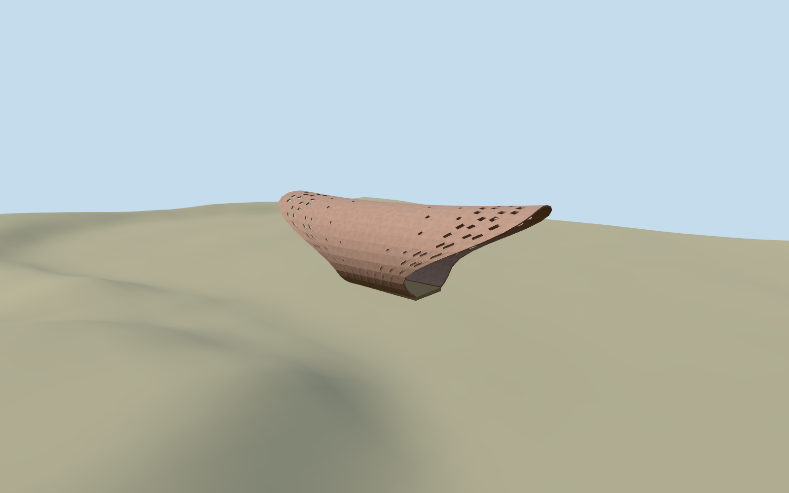

# Carapace Pavilion

Pink concrete shade pavilion with thin double-curved wings and diagrid perforations.

Authoring state: **review-in-qa.json**. Current completion evidence is in [qa.json](qa.json) and the [completion ledger](../../../../qualla-structures/batches/qualla-004.PROGRESS.md).

- [Carapace Pavilion](https://qualla.com/carapace-pavilion/)

The north–south heading is documented. The site point is approximate and the underlying dated bare-earth survey predates installation.

The exact perforation outlines, hidden connections and underside engineering detail are representative.

Build: `node content/worldgen/source/places/9q/9qj/carapace_pavilion/models/generate-carapace-pavilion.mjs`. Add `--check` to verify exact regeneration. 6736 triangles; 3 materials; no embedded photographs.
