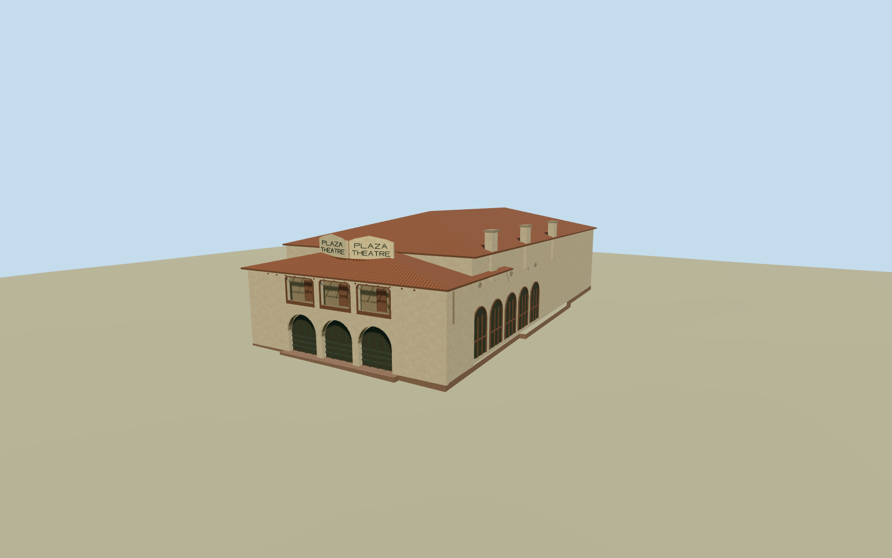

# Plaza Theatre (Palm Springs, California)

The Spanish Colonial Revival Plaza Theatre in Palm Springs, with its triple entry arcade, inset balcony, clay hip roofs and two-faced theatre sign.

Authoring state: **review-in-qa.json**. Current completion evidence is in [qa.json](qa.json) and the [completion ledger](../../../../qualla-structures/batches/qualla-004.PROGRESS.md).

- [Plaza Theatre (Palm Springs, California)](https://qualla.com/plaza-theatre-palm-springs-california/)

The building from the theatre parcel, excluding nearby shops, the pedestrian plaza, and freestanding signs outside the parcel.

The roof profiles and rear fenestration are estimated from the official description and primary photograph.

Build: `node content/worldgen/source/places/9q/9qj/plaza_theatre_palm_springs_california/models/generate-plaza-theatre-palm-springs-california.mjs`. Add `--check` to verify exact regeneration. 2848 triangles; 6 materials; no embedded photographs.
